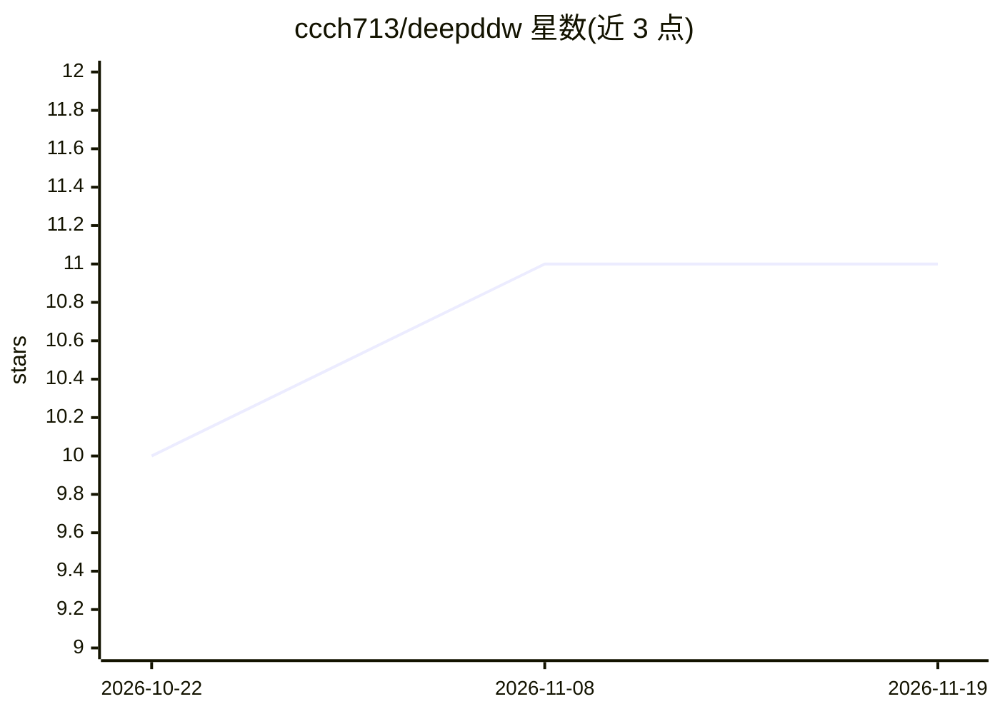

# ccch713/deepddw

⭐ 11 · Python · MIT · 推送 2026-11-02 · [GitHub](https://github.com/ccch713/deepddw) · 个人维护 · 中文 README

**给 DSH 补记忆/知识库/文档搜索，局域网多设备可用**

为 DeepSeek Harness（DSH）补充记忆、知识库与文档搜索的插件型项目：通过 DSH 标准 MCP 接口（streamable-http 端点）接入，不修改 DSH 源码；网关代理使局域网内手机/平板/电脑经浏览器访问同一工作台，支持最多约 20 人/20 台设备的多用户与工作区隔离。提供记忆与知识的打包导出/导入、备份恢复、可选 TLS 与限流。支持 npm 全局安装 DSH 后从源码安装，Windows 提供 CI 打包的 exe。需备份并停用其他记忆/知识库插件以避免数据冲突。

## 筛选速览

| 维度 | 判定 | 备注 |
|---|---|---|
| AI 角色 | `ai-ecosystem` | LLM/agent 周边工具 |
| 许可风险 | `permissive` | MIT |
| 部署形态 | `desktop` | 安装包/桌面程序 |
| 模型依赖 | local-ok | 支持本地模型 |
| 硬件要求 | — | 无带数字的原话,不猜 |
| 安装摩擦 | `low` | 无编译、无系统依赖或容器化 |
| 成熟度 | — | 结构信号不足 |

## 能力要点

- 经 DSH 官方 MCP 接口写入/检索跨会话长期记忆
- 知识库摄取与搜索（行业文档、SOP、研究笔记）
- 局域网网关代理：一次部署，多设备浏览器访问
- 记忆+知识一键打包为 ddw_assets_v1.zip 可迁移

## 适用场景

- 小团队（≤20人）局域网内共享同一份记忆与知识库
- 家庭多成员各自独立记忆命名空间共用一台服务器
- 跨设备续聊：手机接续电脑上的对话

## 场景标签

`Agent 记忆` `知识库管理` · 领域:Agent 开发

## 证据(README 行号)

> L5: # deepDDW — Memory & Knowledge Base for DeepSeek Harness, Reachable from Any Device on Your LAN
> L13: **deepDDW gives DeepSeek Harness (DSH) the three pieces it's missing — memory, a knowledge base, and document searc
> L80: **Integration = DSH standard MCP**: DSH natively supports MCP clients; deepDDW exposes a standard `streamable-http`

## 星数曲线

2026-10-22 10 → 2026-11-19 11（+1）

---
*卡片 v1 · prompt 1.4 · 生成 2026-11-18 · 置信度 high · 依据 README sha `eb569ce9cf1c` · [字段定义](../../DATASET.md)*
