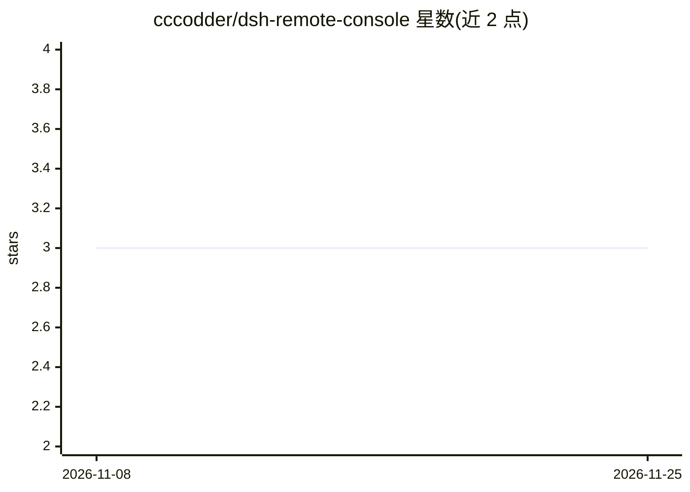

# cccodder/dsh-remote-console

⭐ 3 · JavaScript · MIT · 推送 2026-11-20 · [GitHub](https://github.com/cccodder/dsh-remote-console) · 个人维护 · 中文 README

**DSH 插件：用户与 AI agent 共用同一个 SSH 终端会话**

面向 DSH (DeepSeek Harness) 的插件，在右侧栏提供 SSH 终端，让用户与 agent 共用同一个 PTY、活动日志与审计记录。agent 执行的命令直接显示在用户正在查看的终端中，用户可随时接手输入，shell 状态（如 cwd、环境变量）在双方操作间保持。审计记录命令、退出码、审批、传输 sha256 与端口转发；危险命令（rm -rf、mkfs 等）触发审批，凭据不落盘。安装方式包括插件市场、CLI profile 与桌面版插件管理器。限制：一次会话仅一个终端，渲染与输入复用 DSH 自带终端。

## 筛选速览

| 维度 | 判定 | 备注 |
|---|---|---|
| AI 角色 | `ai-ecosystem` | LLM/agent 周边工具 |
| 许可风险 | `permissive` | MIT |
| 部署形态 | `None` |  |
| 模型依赖 | — | README 未给出锁定关系 |
| 硬件要求 | — | 无带数字的原话,不猜 |
| 安装摩擦 | `low` | 无编译、无系统依赖或容器化 |
| 成熟度 | — | 结构信号不足 |

## 能力要点

- 人机同屏：agent 命令在用户终端中执行，退出码由 PROMPT_COMMAND 钩子回报
- 跨会话审计记录命令、退出码、审批、传输 sha256 与端口转发
- 危险操作弹审批，凭据不落盘、不进日志
- 文件传输与三向端口转发复用已认证的 ControlMaster socket

## 适用场景

- 让 agent 在我能看到和接手的终端里执行远程命令
- 对人和 agent 的操作保留统一审计时间线
- 在 SSH 会话中做文件传输与端口转发而不重复输密码

## 场景标签

`编码 Agent` · 领域:编码与开发

## 证据(README 行号)

> L3: **DSH 右侧栏的 SSH 终端——你和 agent 共用一个窗口。**
> L11: 你 ssh 上去、输完密码，agent 只能在旁边等着——它看不见你的终端。这个插件把 agent 放进**你正在看的那个终端**：它敲的命令你看得见，你随时能接手，双方的操作都落在同一条日志里。
> L38: - **人机同屏**：agent 的命令在你的终端里执行，看得见、能接手；退出码由远端 shell 的 `PROMPT_COMMAND` 钩子回报，不靠猜提示符。

## 星数曲线

2026-11-08 3 → 2026-11-25 3（+0）

---
*卡片 v1 · prompt 1.4 · 生成 2026-11-22 · 置信度 high · 依据 README sha `c73d2f8f829f` · [字段定义](../../DATASET.md)*
