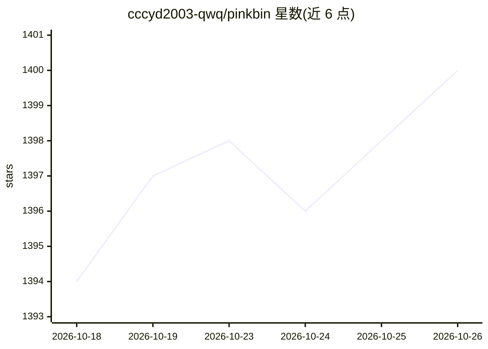

# cccyd2003-qwq/pinkbin

⭐ 1,400 · TypeScript · MIT · 推送 2026-07-14 · [GitHub](https://github.com/cccyd2003-qwq/pinkbin) · [官网](https://github.com/cccyd2003-qwq/pinkbin) · 个人维护 · 中文 README

**带 AI 问答的 Windows 磁盘扫描清理工具**

基于 Tauri 2 + React + Rust 的开源磁盘清理桌面应用。通过 Windows 直读 NTFS MFT（跨平台用 jwalk）在数秒内完成整盘扫描，输出彩色 treemap 与树状视图；用户可将陌生文件夹拖入聊天框，由 BYOK 接入的 LLM（Anthropic/OpenAI/Gemini/Ollama）基于目录元数据解释其用途与删除影响，不读取文件内容。内置微信 PC 端（22 个 scope）与 Conda 环境清理脚本，删除默认进回收站并记录 undo 日志。目前仅提供 Windows 10/11 预编译安装包，macOS/Linux 需自行编译。

## 筛选速览

| 维度 | 判定 | 备注 |
|---|---|---|
| AI 角色 | `ai-enhanced` | 去掉 AI 部分产品仍成立 |
| 许可风险 | `permissive` | MIT |
| 部署形态 | `desktop` | 安装包/桌面程序 |
| 模型依赖 | local-ok | 支持本地模型 |
| 硬件要求 | — | 无带数字的原话,不猜 |
| 安装摩擦 | `low` | 无编译、无系统依赖或容器化 |
| 成熟度 | — | 结构信号不足 |

## 能力要点

- Windows 直读 NTFS MFT，整盘扫描 2–5 秒
- 拖拽文件夹到聊天框，AI 基于目录元数据（不含文件内容）解释能否删除
- 微信 PC 端（22 scope）与 Conda 环境专属清理脚本，带红线安全测试
- 删除默认进回收站，写入 undo.jsonl，数据不上云

## 适用场景

- 找出磁盘里占空间的大文件夹并看懂空间分配
- 问 AI 某个陌生文件夹是什么、能不能删
- 安全清理微信缓存和过期 Conda 环境

## 场景标签

 · 领域:系统工具/磁盘清理

## 证据(README 行号)

> L7: 开源磁盘清理工具。秒扫整盘看空间分配，把不认识的文件夹拖给 AI 让它告诉你这是什么、能不能删、删了会丢什么，再按 scope 逐项放心删——默认进回收站，永远不读你的文件内容。
> L51: 不认识的文件夹？把它从左边树或右边路径**拖进中间聊天框**，AI 解释这是什么、能不能删、删了会丢什么。BYOK——你提供 Anthropic / OpenAI / Gemini 的 Key，或本地跑 Ollama 完全免费。
> L90: |AI|BYOK · Anthropic · OpenAI · Gemini · Ollama 四协议|

## 星数曲线

2026-10-18 1,394 → 2026-10-26 1,400（+6）

---
*卡片 v1 · prompt 1.4 · 生成 2026-10-21 · 置信度 mid · 依据 README sha `0b1504e35f8a` · [字段定义](../../DATASET.md)*
