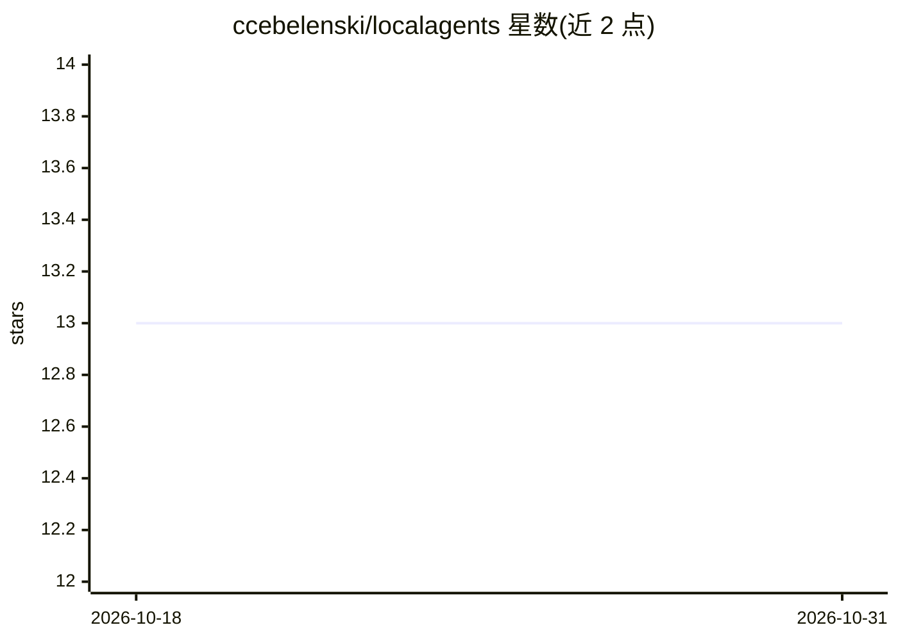

# ccebelenski/localagents

⭐ 13 · Python · MIT · 推送 2026-10-29 · [GitHub](https://github.com/ccebelenski/localagents) · 个人维护

**把 Claude Code 的代理任务转给本地模型执行的 MCP 服务器**

面向 Claude Code 用户的 MCP 服务器，提供 run_agent 等工具：每次调用启动一个无头 Claude Code 会话，但 API 流量改发给用户自运行的 llama.cpp 或 vLLM 服务器；Claude 写任务简报，本地模型执行，Claude 审阅结果，以此节省 Anthropic token 预算。核心机制包括：按端点而非模型配置（每次调用经 /v1/models 发现服务）、Claude Code 与本地后端之间的协议转换 shim、可选 git worktree 隔离。限制：明确不支持 Ollama，要求模型具备 128k 上下文与原生工具调用，README 自述项目处于早期阶段、接口会变动。安装方式为 git clone 后 uv tool install。

## 筛选速览

| 维度 | 判定 | 备注 |
|---|---|---|
| AI 角色 | `ai-ecosystem` | LLM/agent 周边工具 |
| 许可风险 | `permissive` | MIT |
| 部署形态 | `None` |  |
| 模型依赖 | local-ok | 支持本地模型 |
| 硬件要求 | — | 无带数字的原话,不猜 |
| 安装摩擦 | `low` | 无编译、无系统依赖或容器化 |
| 成熟度 | `idea` | |

## 能力要点

- run_agent 工具将 Claude Code 任务委派给本地 llama.cpp / vLLM 服务器
- 协议转换 shim 处理 Claude Code 与本地后端的双向兼容，记录 requests.jsonl
- list_models 实时发现端点、上下文窗口与槽位占用，配置只写端点不写模型
- 可选 git worktree 隔离（local-agent/<job> 分支），保留 diffstat 供审查

## 适用场景

- 把写测试、加 CLI 这类执行性编码任务交给本地模型，保留 Anthropic 预算给设计讨论
- 并行运行两个本地代理分别开发同一个包的两半
- 在自有硬件上运行代理任务并审计每次后端请求

## 场景标签

`编码 Agent` · 领域:编码与开发

## 证据(README 行号)

> L5: localagents is an MCP server that gives Claude Code a `run_agent` tool. Each call
> L7: working tree — except its API traffic goes to a llama.cpp or vLLM server you run

## 星数曲线

2026-10-18 13 → 2026-10-31 13（+0）

---
*卡片 v1 · prompt 1.4 · 生成 2026-10-31 · 置信度 high · 依据 README sha `ca03c79b74d6` · [字段定义](../../DATASET.md)*
