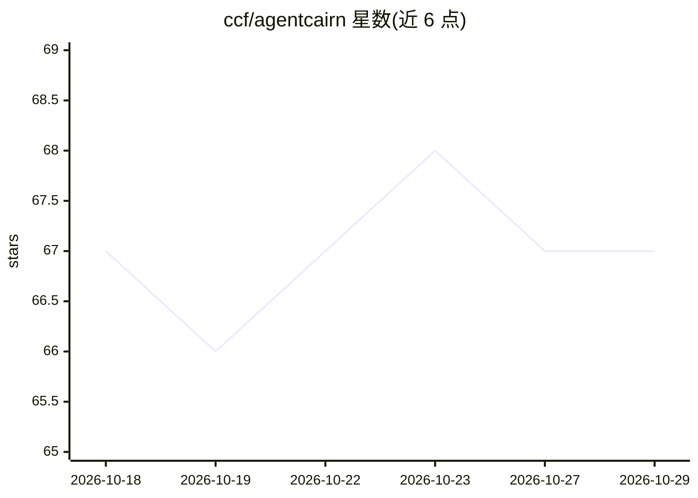

# ccf/agentcairn

⭐ 67 · Python · Apache-2.0 · 推送 2026-10-22 · [GitHub](https://github.com/ccf/agentcairn) · [官网](https://agentcairn.dev) · 组织维护

**给 AI 编程 agent 的跨项目长期记忆层，Markdown 为唯一事实源**

为 Claude Code、Codex、Cursor、OpenCode 等编程 agent 提供共享的长期记忆：捕获会话中的持久上下文，写入带溯源的 Markdown vault，其他 agent 通过 MCP 召回最相关片段。DuckDB 索引为可丢弃的检索缓存，删除重建不影响 Markdown；检索采用 BM25 与本地语义向量（FastEmbed/nomic-embed）经 RRF 融合并可加重排，失败时回退 BM25。默认本地运行、无守护进程、无遥测；支持凭据脱敏、重要性门控、时效字段与项目感知召回。提供 CLI（uv tool install agentcairn，需 Python 3.11+）、插件与独立 MCP server 三种使用方式。

## 筛选速览

| 维度 | 判定 | 备注 |
|---|---|---|
| AI 角色 | `ai-ecosystem` | LLM/agent 周边工具 |
| 许可风险 | `permissive` | Apache-2.0 |
| 部署形态 | `library` | 以包/库形式分发 |
| 模型依赖 | — | README 未给出锁定关系 |
| 硬件要求 | — | 无带数字的原话,不猜 |
| 安装摩擦 | `low` | 无编译、无系统依赖或容器化 |
| 成熟度 | — | 结构信号不足 |

## 能力要点

- 跨 agent 共享同一 Markdown vault，索引（DuckDB）为可丢弃缓存
- BM25+语义向量 RRF 融合检索，可选重排，模型失败回退 BM25
- 本地 FastEmbed 嵌入、stdio MCP、无守护进程、无遥测
- 支持 Claude Code/Codex/Cursor/OpenCode 等 9 类宿主的安装集成

## 适用场景

- 多个编程 agent 共用一份可人工编辑的长期记忆
- 把 Claude Code 的自动记忆导入共享 vault 迁移到其他工具
- 在会话压缩/结束时自动捕获持久上下文供后续召回
- 在 Obsidian 中查看记忆的溯源、时效与图谱

## 场景标签

`Agent 记忆` · 领域:Agent 开发

## 证据(README 行号)

> L17: A cairn marks a trail for whoever comes next. **agentcairn** does that for coding agents: it captures durable conte
> L80: |**One vault crosses agents**|Supported hosts share the same configured vault instead of building isolated memories
> L90: - **Recall:** BM25 and semantic vectors are fused with Reciprocal Rank Fusion, then optionally reranked. Model/prov

## 星数曲线

2026-10-18 67 → 2026-10-29 67（+0）

---
*卡片 v1 · prompt 1.4 · 生成 2026-10-24 · 置信度 mid · 依据 README sha `f9d92b9f0d8f` · [字段定义](../../DATASET.md)*
