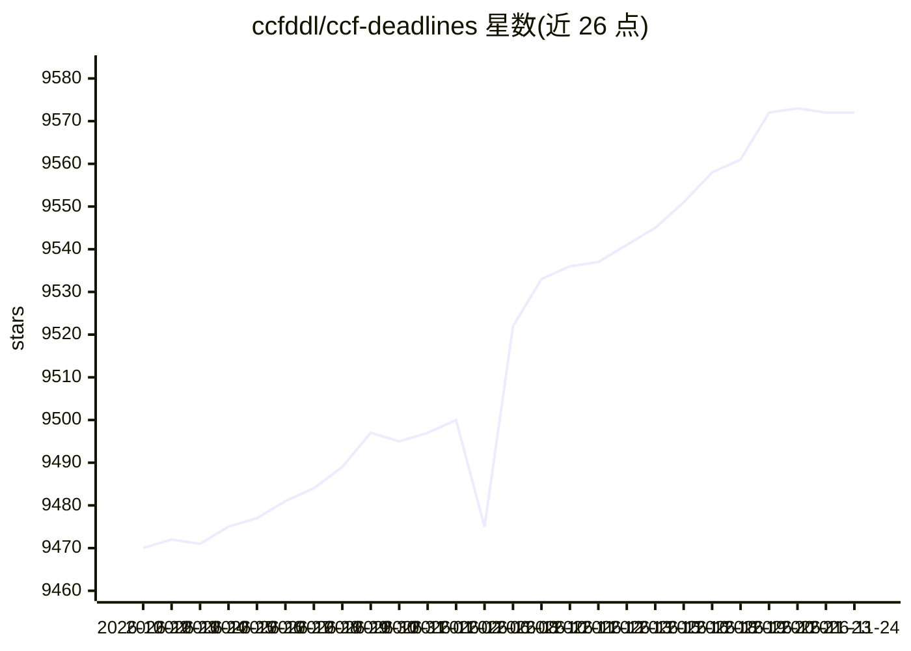

# ccfddl/ccf-deadlines

⭐ 9,572 · Rust · MIT · 推送 2026-11-22 · [GitHub](https://github.com/ccfddl/ccf-deadlines) · [官网](https://ccfddl.com) · 个人维护 · 中文 README

**帮助科研人员跟踪 CCF 及全球会议截止日期**

以 YAML 数据文件维护会议条目（标题、CCF/CORE/THCPL 等级、摘要/投稿/答复/录用日期、时区、地点），通过社区 PR 协作更新；提供网站门户、微信小程序、CLI、Raycast/SwiftBar/Chrome 扩展、TUI、iCal 订阅等多种消费形式，并提供只读 MCP 服务器供 AI 客户端查询会议、截止日期与历史录用率，支持 CCF/CORE/THCPL 过滤、分页与时区转换。

## 筛选速览

| 维度 | 判定 | 备注 |
|---|---|---|
| AI 角色 | `ai-knowledge` | 知识聚合/清单类 |
| 许可风险 | `permissive` | MIT |
| 部署形态 | `None` |  |
| 模型依赖 | — | README 未给出锁定关系 |
| 硬件要求 | — | 无带数字的原话,不猜 |
| 安装摩擦 | `low` | 无编译、无系统依赖或容器化 |
| 成熟度 | — | 结构信号不足 |

## 能力要点

- YAML 格式会议条目，社区通过 fork+PR 维护
- 只读 MCP 服务器（Streamable HTTP）供 AI 客户端查询
- 网站/小程序/CLI/扩展/iCal 等多种访问方式
- 记录 abstract/rebuttal/decision 等多类日期与时区约定

## 适用场景

- 查询某 CCF 会议今年的投稿截止日期
- 通过 iCal 或状态栏工具跟踪多个会议 ddl
- 让 AI 客户端通过 MCP 检索会议信息与历史录用率

## 场景标签

`科研工具` · 领域:学习与行业

## 证据(README 行号)

> L3: > Helping researchers track worldwide conference ddls through (agentic) collaboration.
> L31: CCFDDL provides a read-only Model Context Protocol (MCP) server for AI clients to search conferences, check publish

## 星数曲线

2026-10-22 9,470 → 2026-11-24 9,572（+102）

---
*卡片 v1 · prompt 1.4 · 生成 2026-11-22 · 置信度 high · 依据 README sha `b50abb2131c3` · [字段定义](../../DATASET.md)*
