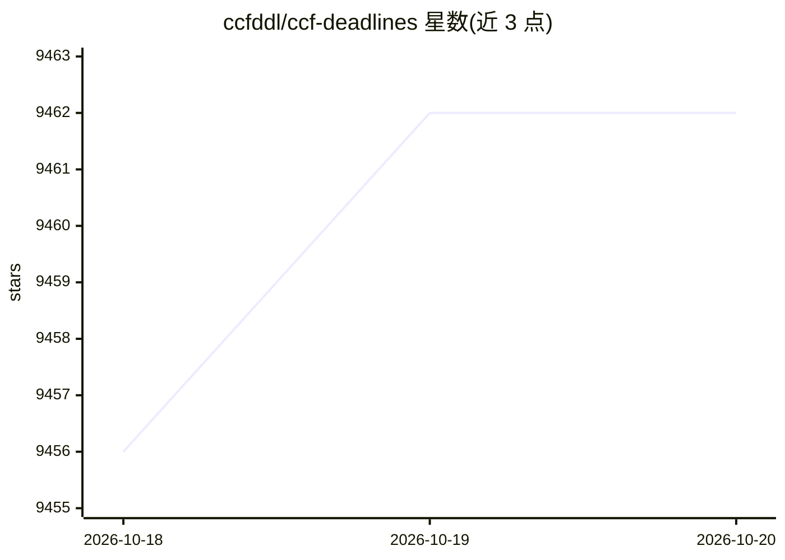

# ccfddl/ccf-deadlines

⭐ 9,462 · Rust · MIT · 推送 2026-10-19 · [GitHub](https://github.com/ccfddl/ccf-deadlines) · [官网](https://ccfddl.com) · 组织维护 · 中文 README

**面向科研人员的会议截止日期追踪工具（网站/CLI/小程序）**

由 @ccfddl 协作维护的会议截稿日期数据集与追踪平台：以 yml 文件收录 CCF/CORE/THCPL 分级的会议信息（标题、级别、时间线、时区、地点），社区通过 PR 增改条目。访问渠道包括网站门户、微信小程序、Python CLI、Raycast 扩展、Chrome 扩展、TUI、iCal 订阅等，另提供只读 MCP 服务器（Streamable HTTP，支持分级过滤、分页、时区转换、历史录取率查询）供 AI 客户端检索。

## 筛选速览

| 维度 | 判定 | 备注 |
|---|---|---|
| AI 角色 | `ai-knowledge` | 知识聚合/清单类 |
| 许可风险 | `permissive` | MIT |
| 部署形态 | `None` |  |
| 模型依赖 | — | README 未给出锁定关系 |
| 硬件要求 | — | 无带数字的原话,不猜 |
| 安装摩擦 | `low` | 无编译、无系统依赖或容器化 |
| 成熟度 | — | 结构信号不足 |

## 能力要点

- yml 格式的会议条目数据集，含 CCF/CORE/THCPL 分级与时间线字段
- 只读 MCP 服务器：会议检索、截稿/开奖日期、历史录取率查询
- 多访问渠道：网站、微信小程序、Python CLI、Raycast、Chrome 扩展、TUI、iCal 订阅
- 社区通过 Fork + PR 增改会议信息

## 适用场景

- 投稿前查各会议的截稿时间与时间线
- 通过 iCal 订阅在日历中跟踪会议 ddl
- 让 AI 客户端经 MCP 检索会议信息与历史录取率

## 场景标签

`科研工具` · 领域:学习与行业

## 证据(README 行号)

> L3: > Helping researchers track worldwide conference ddls through (agentic) collaboration.
> L27: CCFDDL provides a read-only Model Context Protocol (MCP) server for AI clients to search conferences, check publish

## 星数曲线

2026-10-18 9,456 → 2026-10-20 9,462（+6）

---
*卡片 v1 · prompt 1.4 · 生成 2026-10-20 · 置信度 high · 依据 README sha `6c2f46ad3532` · [字段定义](../../DATASET.md)*
