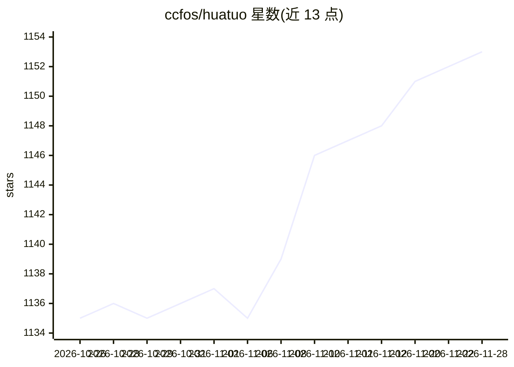

# ccfos/huatuo

⭐ 1,153 · Go · Apache-2.0 · 推送 2026-11-27 · [GitHub](https://github.com/ccfos/huatuo) · [官网](https://huatuo.tech/) · 组织维护 · 中文 README

**给 Linux 内核与 AI 基础设施提供内核级可观测性**

滴滴开源、CCF 孵化的云原生操作系统可观测性项目，整合 kprobes、tracepoints、ftrace 与 eBPF 实现内核级监控，性能开销低于 1%。提供内核全栈洞察（内存、CPU 调度、网络、块 I/O）、事件驱动的运行时上下文捕获、自动快照保留的 AutoTracing 与持续性能剖析，覆盖 GPU/NPU 等异构硬件，并与 Prometheus、Grafana、Elasticsearch 等栈集成，关联 Kubernetes 容器标签。已在滴滴生产环境规模化部署。

## 筛选速览

| 维度 | 判定 | 备注 |
|---|---|---|
| AI 角色 | `ai-enhanced` | 去掉 AI 部分产品仍成立 |
| 许可风险 | `permissive` | Apache-2.0 |
| 部署形态 | `self-host` | docker 或自建部署 |
| 模型依赖 | — | README 未给出锁定关系 |
| 硬件要求 | — | 无带数字的原话,不猜 |
| 安装摩擦 | `low` | 无编译、无系统依赖或容器化 |
| 成熟度 | — | 结构信号不足 |

## 能力要点

- 基于 eBPF 的内核级全栈可观测，性能开销低于 1%
- AutoTracing 自动快照保留，处理 CPU idle 下降、I/O 激增等抖动
- 覆盖 GPU/NPU 等异构 AI 计算硬件
- 集成 Prometheus/Grafana/Pyroscope/Elasticsearch，自动关联 K8s 容器标签

## 适用场景

- 排查云原生环境下的系统故障与性能抖动
- 对 AI 计算基础设施做内核级持续监控
- 对操作系统与应用做持续性能剖析
- 零侵入接入现有可观测性技术栈

## 场景标签

 · 领域:系统运维/可观测性

## 证据(README 行号)

> L24: **HUATUO**, named after Hua Tuo, a legendary physician in ancient China, is a cloud-native OS observability project
> L34: - **Heterogeneous Computing Hardware**: Encompassing core system components such as CPUs, memory, PCIe interconnect

## 星数曲线

2026-10-26 1,135 → 2026-11-28 1,153（+18）

---
*卡片 v1 · prompt 1.4 · 生成 2026-11-26 · 置信度 high · 依据 README sha `9cc7edefb1b9` · [字段定义](../../DATASET.md)*
