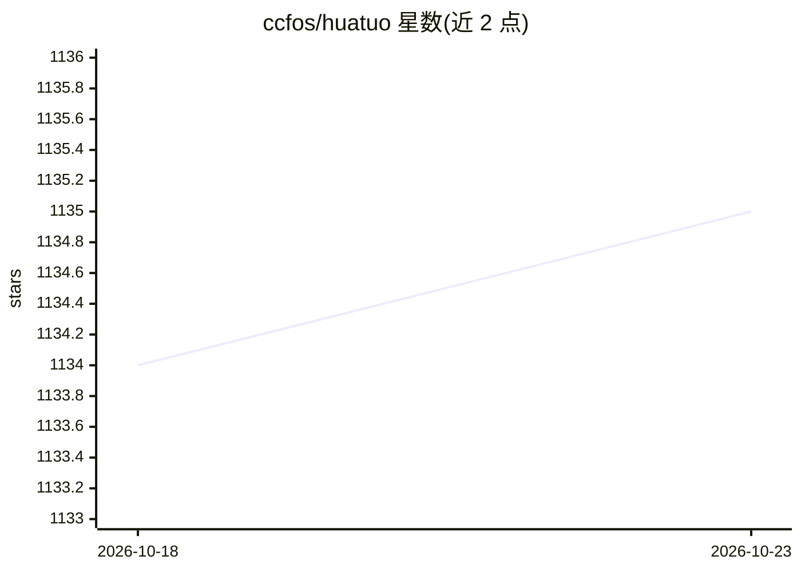

# ccfos/huatuo

⭐ 1,135 · Go · Apache-2.0 · 推送 2026-10-22 · [GitHub](https://github.com/ccfos/huatuo) · [官网](https://huatuo.tech/) · 组织维护 · 中文 README

**基于 eBPF 的 Linux 内核级可观测性平台，服务云原生与 AI 基础设施**

滴滴开源、CCF 孵化的云原生操作系统可观测性项目：集成 kprobe、tracepoint、ftrace、eBPF 等内核动态追踪技术，提供内核级指标、事件驱动的上下文捕获（如缺页、调度延迟）、AutoTracing 自动快照与持续 Profiling（CPU/内存/I/O/锁），覆盖 CPU、内存、PCIe、GPU/NPU 等异构硬件。面向云原生、AI 计算与裸金属场景的运维和稳定性工程人员，支持 Prometheus/Grafana/Pyroscope/Elasticsearch 生态集成，零插桩部署。要求 Linux 内核 4.18+，已在滴滴生产环境规模部署。

## 筛选速览

| 维度 | 判定 | 备注 |
|---|---|---|
| AI 角色 | `ai-enhanced` | 去掉 AI 部分产品仍成立 |
| 许可风险 | `permissive` | Apache-2.0 |
| 部署形态 | `self-host` | docker 或自建部署 |
| 模型依赖 | — | README 未给出锁定关系 |
| 硬件要求 | — | 无带数字的原话,不猜 |
| 安装摩擦 | `low` | 无编译、无系统依赖或容器化 |
| 成熟度 | — | 结构信号不足 |

## 能力要点

- eBPF 零插桩内核级追踪，性能开销低于 1%
- 事件驱动上下文自动捕获与 AutoTracing 快照留存
- 持续 Profiling 覆盖 CPU/内存/I/O/锁
- 覆盖 GPU/NPU 等异构算力硬件，支持 K8s 标签自动关联

## 适用场景

- 排查云原生或 AI 训练集群的系统故障与性能抖动
- 对 Linux 内核与全栈应用做持续性能剖析
- 接入现有 Prometheus/Grafana 可观测体系监控内核指标

## 场景标签

 · 领域:系统可观测性/云原生基础设施

## 证据(README 行号)

> L24: **HUATUO** is a cloud-native operating system observability project open-sourced by **DIDI** and incubated under th
> L25: By integrating Linux kernel dynamic tracing technologies like **kprobe**, **tracepoint**, **ftrace**, and **eBPF**,
> L36: - **Heterogeneous Computing Hardware**: Encompassing core system components such as CPUs, memory, PCIe interconnect

## 星数曲线

2026-10-18 1,134 → 2026-10-23 1,135（+1）

---
*卡片 v1 · prompt 1.4 · 生成 2026-10-21 · 置信度 high · 依据 README sha `f2c1e70d18bc` · [字段定义](../../DATASET.md)*
