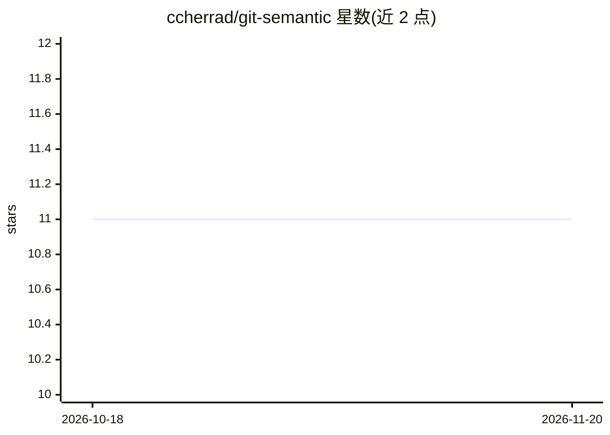

# ccherrad/git-semantic

⭐ 11 · Rust · 推送 2026-05-11 · [GitHub](https://github.com/ccherrad/git-semantic) · [官网](https://git-ism.github.io/) · 个人维护

**为 AI 编码代理提供代码库语义索引与检索的 Git CLI 工具**

用 Rust 编写的 Git 仓库语义检索工具：以 tree-sitter 解析追踪文件并按块生成向量嵌入，存储于 orphan 的 semantic 分支供团队共享，免重复嵌入；索引时用 Leiden 社区检测构建子系统空间地图并跟踪跨文件调用边。检索为 BM25 (SQLite FTS5) + 语义嵌入 + 图邻近的混合三信号，经 RRF 融合。提供 map/get/grep/health/benchmark/mcp 命令，通过 MCP 暴露给 Claude Code、Cursor、Windsurf 等客户端。安装需 cargo 与 Rust 1.65+、Git 2.0+，支持 Rust/Python/JS/TS/Java/C/C++/Go 八种语言。

## 筛选速览

| 维度 | 判定 | 备注 |
|---|---|---|
| AI 角色 | `ai-ecosystem` | LLM/agent 周边工具 |
| 许可风险 | `none` | — |
| 部署形态 | `library` | 以包/库形式分发 |
| 模型依赖 | — | README 未给出锁定关系 |
| 硬件要求 | — | 无带数字的原话,不猜 |
| 安装摩擦 | `low` | 无编译、无系统依赖或容器化 |
| 成熟度 | — | 结构信号不足 |

## 能力要点

- 嵌入与空间地图存于 orphan Git 分支，一次索引团队共享
- BM25+语义+图邻近三信号混合检索，RRF 融合
- tree-sitter 驱动的 outline/signatures 读取模式降低 token 消耗
- 内置 MCP 服务器，接入 Claude Code/Cursor/Windsurf 等客户端

## 适用场景

- 让编码代理在大型仓库中快速定位相关子系统与代码位置
- 团队共享代码库语义索引，成员无需各自的 API key
- CI 中自动刷新语义索引保持团队地图最新

## 场景标签

`编码 Agent` `语义搜索` · 领域:编码与开发

## 证据(README 行号)

> L5: `git-semantic` parses every tracked file with tree-sitter, generates vector embeddings per chunk, and stores them on
> L159: Starts the MCP server (JSON-RPC over stdio). Exposes `map`, `get`, `grep`, and `health` as tools to any MCP-compat

## 星数曲线

2026-10-18 11 → 2026-11-20 11（+0）

---
*卡片 v1 · prompt 1.4 · 生成 2026-11-18 · 置信度 high · 依据 README sha `3df6a153911e` · [字段定义](../../DATASET.md)*
