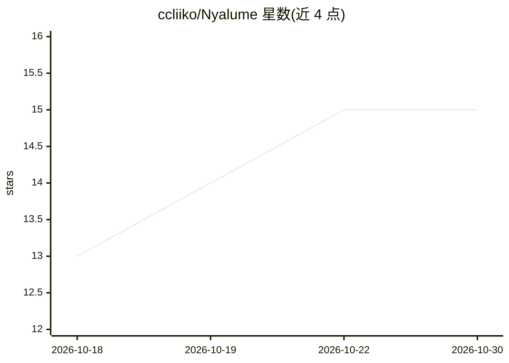

# ccliiko/Nyalume

⭐ 15 · Python · NOASSERTION · 推送 2026-10-25 · [GitHub](https://github.com/ccliiko/Nyalume) · [官网](https://t.bilibili.com/1246772664677171207) · 个人维护 · 中文 README

**Windows 个人 AI 助手与二次元桌宠，带长期记忆与工具调用**

面向 Windows 用户的多前端 AI 助手：通过 2D/3D 桌宠、网页和命令行进行多轮流式对话，支持长期记忆便签、记忆卡片、对话摘要、每日卡片等陪伴功能，以及网页搜索、文件操作与 PDF/Word/Excel/PPT 处理等工具。模型接入 DeepSeek、OpenAI、OpenRouter、硅基流动及 OpenAI 兼容服务。3D 桌宠支持用户自备 PMX/VRM 模型与 VMD 动作。本地单用户应用，源码可见的商业软件，需自备 API Key。

## 筛选速览

| 维度 | 判定 | 备注 |
|---|---|---|
| AI 角色 | `ai-native` | 本体是模型或模型工具 |
| 许可风险 | `none` | NOASSERTION |
| 部署形态 | `desktop` | 安装包/桌面程序 |
| 模型依赖 | locked-api |  |
| 硬件要求 | — | 无带数字的原话,不猜 |
| 安装摩擦 | `low` | 无编译、无系统依赖或容器化 |
| 成熟度 | — | 结构信号不足 |

## 能力要点

- 多前端：2D/3D 桌宠、网页、命令行，多轮流式对话与多会话管理
- 长期记忆体系：便签、对话摘要、记忆卡片按用户/主题/领域管理并跨对话召回
- 工具能力：网页搜索、项目文件操作、PDF/Word/Excel/PPT 处理
- 3D 桌宠支持用户自备 PMX/VRM 模型，PMX 可播放 VMD 动作

## 适用场景

- 在桌面养一只可对话的 AI 桌宠，日常陪伴与专注记录
- 通过网页或命令行使用带长期记忆的 AI 助手处理文件与检索资料
- 自备 3D 模型定制桌宠形象与动作

## 场景标签

`AI 助手` · 领域:对话与助手

## 证据(README 行号)

> L3: **v0.5.2** · 面向 Windows 的 AI 助手与二次元桌宠
> L5: Nyalume 将 AI 对话、桌面陪伴与日常工具放在一起。你可以通过桌宠、网页或命令行与它交流，使用长期记忆、文件处理、资料检索、陪伴专注等功能。
> L21: - **模型选择**：支持 DeepSeek、OpenAI、OpenRouter、硅基流动及其他 OpenAI 兼容服务。

## 星数曲线

2026-10-18 13 → 2026-10-30 15（+2）

---
*卡片 v1 · prompt 1.4 · 生成 2026-10-30 · 置信度 mid · 依据 README sha `986add2a23e9` · [字段定义](../../DATASET.md)*
