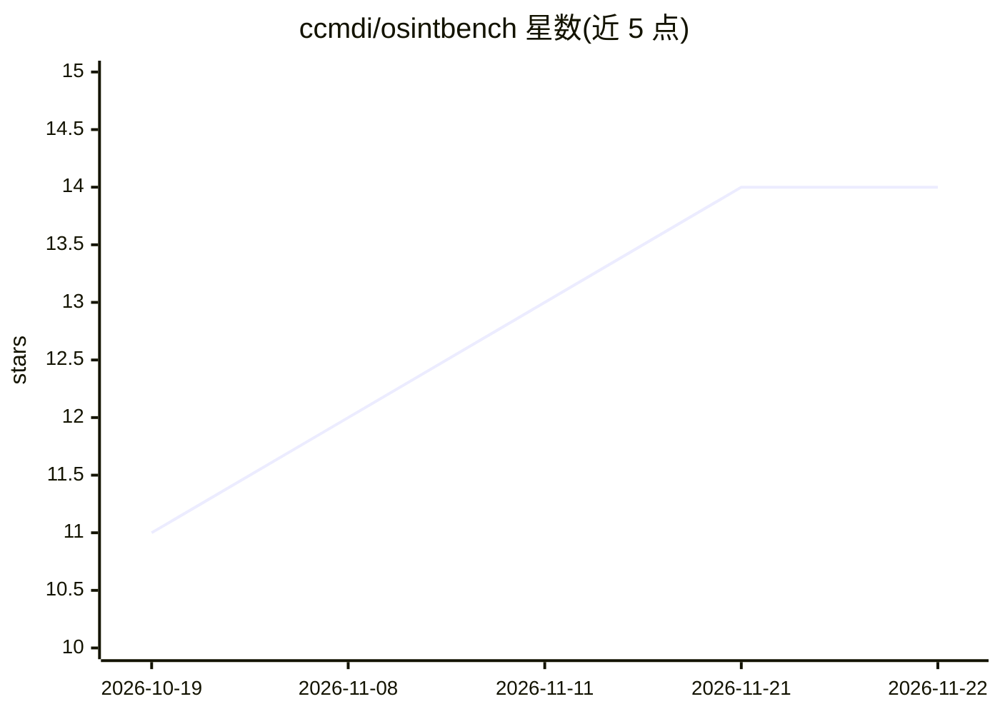

# ccmdi/osintbench

⭐ 14 · Python · MIT · 推送 2025-12-29 · [GitHub](https://github.com/ccmdi/osintbench) · [官网](https://osintbench.org) · 个人维护

**评估 LLM 执行 OSINT 任务的基准工具**

一个用于评测大语言模型在开源情报（OSINT）任务上表现的基准工具，覆盖地理定位、信息识别、时间推理与通用分析四类任务。采用 git clone 获取源码、pip 安装依赖的运行方式；数据集需用户按给定 JSON schema 手动构建；通过命令行指定数据集与模型名运行测试，多数输出由 judge 模型评估，README 提醒需人工复核结果。

## 筛选速览

| 维度 | 判定 | 备注 |
|---|---|---|
| AI 角色 | `ai-ecosystem` | LLM/agent 周边工具 |
| 许可风险 | `permissive` | MIT |
| 部署形态 | `library` | 以包/库形式分发 |
| 模型依赖 | — | README 未给出锁定关系 |
| 硬件要求 | — | 无带数字的原话,不猜 |
| 安装摩擦 | `low` | 无编译、无系统依赖或容器化 |
| 成熟度 | — | 结构信号不足 |

## 能力要点

- 覆盖地理定位、识别、时间、分析四类 OSINT 任务
- 命令行评测：python osintbench.py --dataset <名称> --model <模型名>
- 模型以 models.py 中的类名调用（如 Gemini2_5Flash）
- judge 模型评估输出，README 提示需人工复核

## 适用场景

- 测试不同 LLM 在开源情报任务上的表现
- 自建 OSINT 数据集来评测自己的模型
- 为模型输出 OSINT 能力榜单（leaderboard）

## 场景标签

`模型评测` · 领域:评测与运维

## 证据(README 行号)

> L1: OSINTbench is a benchmark for evaluating how well large language models can perform open-source intelligence (OSINT)
> L35: ## Test a model
> L40: python osintbench.py --dataset <test name> --model <model name>

## 星数曲线

2026-10-19 11 → 2026-11-22 14（+3）

---
*卡片 v1 · prompt 1.4 · 生成 2026-11-18 · 置信度 high · 依据 README sha `e2803b3ff4b0` · [字段定义](../../DATASET.md)*
