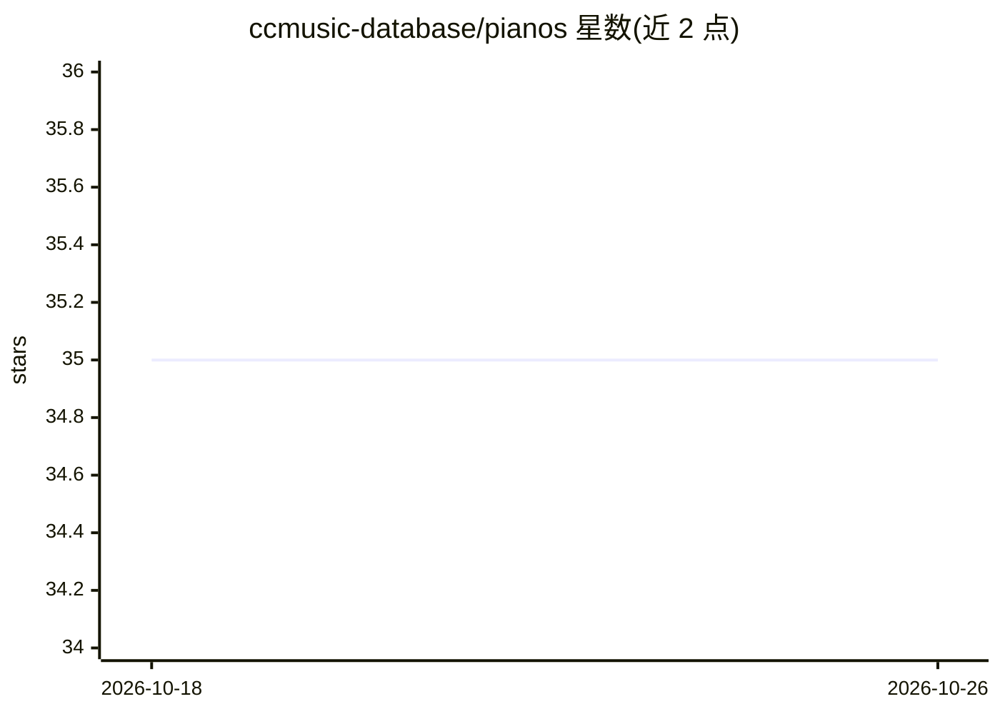

# ccmusic-database/pianos

⭐ 35 · Python · MIT · 推送 2025-10-31 · [GitHub](https://github.com/ccmusic-database/pianos) · [官网](https://www.modelscope.cn/models/ccmusic-database/pianos/resolve/master/mat.jpg) · 组织维护 · 中文 README

**钢琴音质分类研究代码：mel 频谱图 + 微调 CNN 骨干网络**

将钢琴录音转换为 mel 频谱图，再使用微调后的预训练 CNN 骨干网络（如 SqueezeNet）进行音质分类的训练代码库。训练命令支持指定骨干网络、全量微调或线性探测、focal loss 加权等选项，训练后可用脚本绘制损失曲线、准确率与混淆矩阵。配套论文《A Holistic Evaluation of Piano Sound Quality》发表于会议，提供 conda 环境的依赖安装方式，面向复现实验的研究人员。

## 筛选速览

| 维度 | 判定 | 备注 |
|---|---|---|
| AI 角色 | `ai-native` | 本体是模型或模型工具 |
| 许可风险 | `permissive` | MIT |
| 部署形态 | `library` | 以包/库形式分发 |
| 模型依赖 | — | README 未给出锁定关系 |
| 硬件要求 | — | 无带数字的原话,不猜 |
| 安装摩擦 | `low` | 无编译、无系统依赖或容器化 |
| 成熟度 | — | 结构信号不足 |

## 能力要点

- 钢琴录音转 mel 频谱图后用预训练 CNN 分类
- 支持指定骨干网络、全量微调/线性探测、focal loss 选项
- 训练后脚本绘制损失曲线、准确率与混淆矩阵

## 适用场景

- 复现钢琴音质分类对比实验
- 训练自己的钢琴录音音质分类模型
- 比较不同 CNN 骨干网络在音频分类上的表现

## 场景标签

`微调` · 领域:训练与推理

## 证据(README 行号)

> L9: Classify piano sound quality by fine-tuned pre-trained CNN models.
> L28: python train.py --model squeezenet1_1 --fullfinetune True --wce True

## 星数曲线

2026-10-18 35 → 2026-10-26 35（+0）

---
*卡片 v1 · prompt 1.4 · 生成 2026-10-25 · 置信度 mid · 依据 README sha `00fbfb803c63` · [字段定义](../../DATASET.md)*
