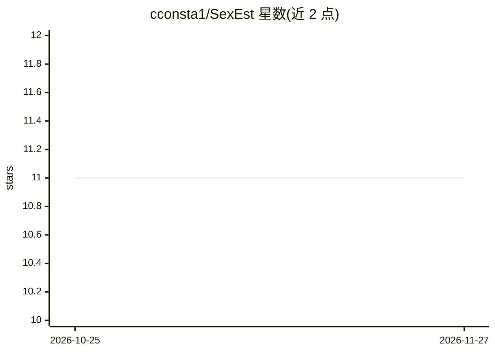

# cconsta1/SexEst

⭐ 11 · Python · Apache-2.0 · 推送 2026-09-15 · [GitHub](https://github.com/cconsta1/SexEst) · [官网](https://sexest.cyi.ac.cy/) · 个人维护

**从骨骼测量数据预测生物性别的机器学习 Web 应用**

基于 Streamlit 的开源 Web 应用，加载预训练的 XGBoost、LightGBM 与线性判别分析模型，输入颅骨或颅后骨骼测量数据即可输出生物性别预测。模型在 Goldman（颅后）与 Howells（颅骨）数据集上训练，论文报告交叉验证准确率约 80–90%。仓库含推理应用、预训练模型文件、示例输入 CSV 与训练笔记链接；提供在线版、本地 pip 运行与 Docker 构建三种方式，Apache 2.0 许可。

## 筛选速览

| 维度 | 判定 | 备注 |
|---|---|---|
| AI 角色 | `ai-native` | 本体是模型或模型工具 |
| 许可风险 | `permissive` | Apache-2.0 |
| 部署形态 | `self-host` | docker 或自建部署 |
| 模型依赖 | — | README 未给出锁定关系 |
| 硬件要求 | — | 无带数字的原话,不猜 |
| 安装摩擦 | `low` | 无编译、无系统依赖或容器化 |
| 成熟度 | — | 结构信号不足 |

## 能力要点

- 加载预训练模型直接输出骨骼性别预测，无需训练
- 支持 Goldman 颅后测量与 Howells 颅骨测量两类输入
- 提供在线演示站点与 Docker 容器化部署
- 附训练数据集来源与论文 DOI 便于复现与引用

## 适用场景

- 考古遗骸的骨骼性别鉴定
- 法医人类学场景中预测未知骨骼样本性别
- 教学中演示机器学习在体质人类学中的应用

## 场景标签

`数据分析` · 领域:效率与自动化

## 证据(README 行号)

> L8: - SexEst is an open-source Streamlit web application for predicting biological sex from skeletal measurements using 
> L11: - Skeletal sex estimation is an essential step in osteoarchaeological and forensic contexts. This project (1) evalu
> L21: - `streamlit_app.py` — Streamlit web UI and inference logic (loads pre-trained models and shows predictions).

## 星数曲线

2026-10-25 11 → 2026-11-27 11（+0）

---
*卡片 v1 · prompt 1.4 · 生成 2026-11-18 · 置信度 high · 依据 README sha `08c9a4384400` · [字段定义](../../DATASET.md)*
