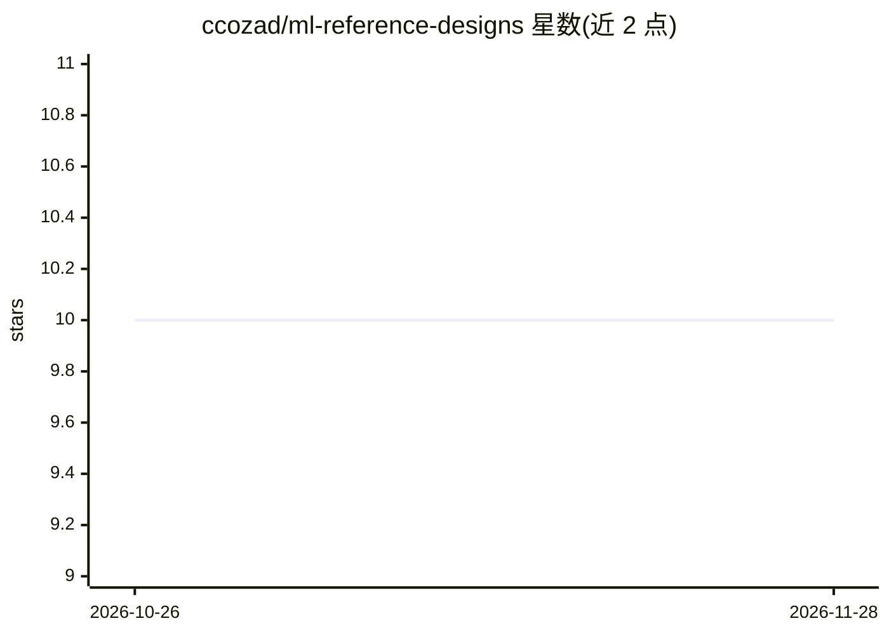

# ccozad/ml-reference-designs

⭐ 10 · Jupyter Notebook · 推送 2026-06-17 · [GitHub](https://github.com/ccozad/ml-reference-designs) · 个人维护

**ML 学习者的参考实现集：覆盖 Agent、RAG、CV 等示例**

面向学习者的机器学习参考设计合集，按主题组织为面试题、Browser Use、Agent、框架入门、特征工程、图像处理、回归/分类/聚类/时序、CV、LLM/SLM 与部署等板块。示例以 Jupyter 交互运行为主，脚本类示例附独立 README；提供 Windows 虚拟环境搭建命令与 NodeJS 环境说明。限制：LLM 相关示例需额外设置，Llama 3 权重需向 Meta 申请且体量达 GB 级，作者指出部分模型在 Windows 上可能无法良好运行。

## 筛选速览

| 维度 | 判定 | 备注 |
|---|---|---|
| AI 角色 | `ai-knowledge` | 知识聚合/清单类 |
| 许可风险 | `none` | — |
| 部署形态 | `library` | 以包/库形式分发 |
| 模型依赖 | — | README 未给出锁定关系 |
| 硬件要求 | — | 无带数字的原话,不猜 |
| 安装摩擦 | `medium` | 含编译或系统依赖之一 |
| 成熟度 | — | 结构信号不足 |

## 能力要点

- 覆盖 Agent、LangChain/LangGraph RAG、图像处理、时序预测等多主题参考实现
- 示例以 Jupyter-Lab 交互方式运行，仓库提供 CLAUDE.md 供 AI 编码助手定位
- 含行业域问题索引（会计、医疗、交通、零售等十余领域）
- 附延伸阅读清单（ReAct、Attention Is All You Need 等）

## 适用场景

- 系统学习 PyTorch、scikit-learn、OpenCV 等框架的常见任务写法
- 参考 LangGraph/LangChain 搭建 RAG 与多 Agent 流水线
- 准备 AI 工程师面试题
- 查找特定行业（医疗/零售/交通）的 ML 示例实现

## 场景标签

`RAG` `教程课程` · 领域:知识与检索

## 证据(README 行号)

> L3: This repo contains a set of reference designs for various ML topics. A few examples of the types of things you can l
> L5: # Contents
> L204: # Setup

## 星数曲线

2026-10-26 10 → 2026-11-28 10（+0）

---
*卡片 v1 · prompt 1.4 · 生成 2026-11-19 · 置信度 high · 依据 README sha `cd1aac629b97` · [字段定义](../../DATASET.md)*
