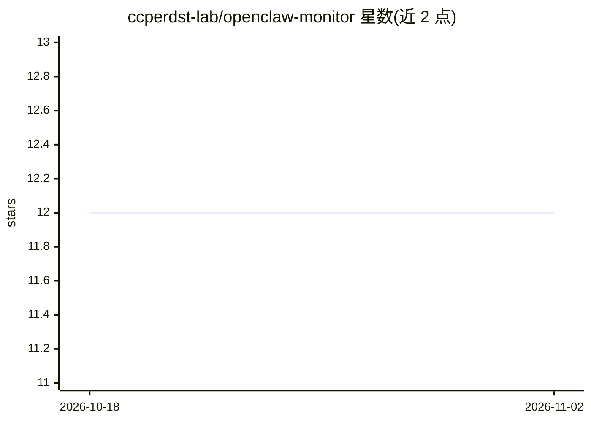

# ccperdst-lab/openclaw-monitor

⭐ 12 · JavaScript · 推送 2026-04-11 · [GitHub](https://github.com/ccperdst-lab/openclaw-monitor) · [官网](https://github.com/ccperdst-lab/openclaw-monitor) · 组织维护 · 中文 README

**OpenClaw AI agent 的实时 3D 可视化监控面板**

基于 Three.js 的 Web 仪表盘，用于监控 OpenClaw AI agent 集群：每个 agent 对应一个程序生成的大陆村庄，每个会话对应一个带物理系统与寻路的 minion 角色。通过 SSE 实时流式读取 OpenClaw 的会话 JSONL 文件，在对话气泡中展示思考内容、工具调用与结果，支持直接向会话发消息、中止运行、世界聊天广播，并内置可选的登录认证与用户管理后台。需本机已安装并运行 OpenClaw，通过 git clone + npm 安装运行。

## 筛选速览

| 维度 | 判定 | 备注 |
|---|---|---|
| AI 角色 | `ai-ecosystem` | LLM/agent 周边工具 |
| 许可风险 | `permissive` | — |
| 部署形态 | `library` | 以包/库形式分发 |
| 模型依赖 | — | README 未给出锁定关系 |
| 硬件要求 | — | 无带数字的原话,不猜 |
| 安装摩擦 | `low` | 无编译、无系统依赖或容器化 |
| 成熟度 | — | 结构信号不足 |

## 能力要点

- SSE 实时读取 OpenClaw 会话 JSONL，无需修改 OpenClaw
- 每会话一个 minion 角色，含物理系统、AABB 碰撞与寻路
- 对话气泡展示思考/工具调用/结果，支持直接发消息与中止运行
- 可选认证体系：admin/user/viewer 三角色与秘密 URL 管理面板

## 适用场景

- 实时查看多个 OpenClaw agent 会话的运行状态与活动
- 直接与某个 agent 会话对话或中止其运行
- 通过管理面板管理用户与排查卡死的会话

## 场景标签

`LLM 可观测性` · 领域:评测与运维

## 证据(README 行号)

> L155: The monitor server tails OpenClaw's session JSONL files and broadcasts events to all connected browsers via SSE. N
> L120: Requires OpenClaw to be installed and running on the same machine.

## 星数曲线

2026-10-18 12 → 2026-11-02 12（+0）

---
*卡片 v1 · prompt 1.4 · 生成 2026-11-01 · 置信度 high · 依据 README sha `0c838bae0fbf` · [字段定义](../../DATASET.md)*
