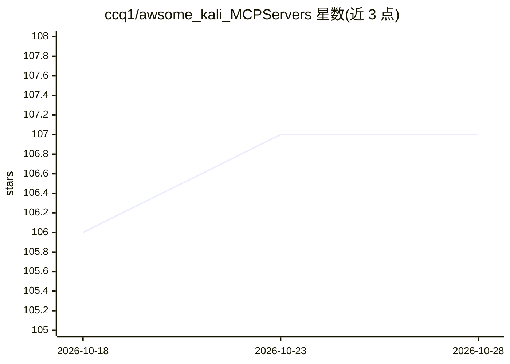

# ccq1/awsome_kali_MCPServers

⭐ 108 · Python · Apache-2.0 · 推送 2025-11-16 · [GitHub](https://github.com/ccq1/awsome_kali_MCPServers) · 个人维护

**面向 Kali Linux 的 MCP 服务器集合：为安全测试提供工具接入**

在 Kali Linux 环境中运行的 Model Context Protocol (MCP) 服务器集合，基于 FastMCP 框架封装 Nmap 网络扫描、nm 符号分析、objdump 反汇编、strings 字符串提取、tshark 流量分析等 Kali 内置工具，通过 Docker 镜像构建并以容器方式接入 MCP 客户端（如 claude desktop、cline、goose、roo code）。另提供 Docker 沙箱功能：隔离容器内执行命令，可配置内存/CPU 限制、网络模式与超时，支持宿主机与容器间双向文件复制。作者自述项目尚处早期阶段。

## 筛选速览

| 维度 | 判定 | 备注 |
|---|---|---|
| AI 角色 | `ai-ecosystem` | LLM/agent 周边工具 |
| 许可风险 | `permissive` | Apache-2.0 |
| 部署形态 | `self-host` | docker 或自建部署 |
| 模型依赖 | — | README 未给出锁定关系 |
| 硬件要求 | — | 无带数字的原话,不猜 |
| 安装摩擦 | `low` | 无编译、无系统依赖或容器化 |
| 成熟度 | `idea` | |

## 能力要点

- 基于 FastMCP 框架封装 Nmap/nm/objdump/strings/tshark 等 Kali 工具
- Docker 镜像构建并经 MCP 客户端配置接入
- 沙箱功能：隔离容器执行命令，可配内存/CPU/网络/超时，支持双向文件复制

## 适用场景

- 安全研究人员通过 MCP 客户端调用 Kali 工具做网络扫描与流量分析
- 逆向工程任务中调用反汇编、符号与字符串分析工具
- 在隔离沙箱中安全执行命令并复制文件

## 场景标签

`网络安全` · 领域:学习与行业

## 证据(README 行号)

> L4: Welcome to awsome-kali-MCPServers! This repository is a collection of Model Context Protocol (MCP) servers designed 
> L41: Since the last update, we have added the following features, integrating a series of tools based on the FastMCP fra

## 星数曲线

2026-10-18 106 → 2026-10-28 107（+1）

---
*卡片 v1 · prompt 1.4 · 生成 2026-10-23 · 置信度 high · 依据 README sha `e912a39be283` · [字段定义](../../DATASET.md)*
