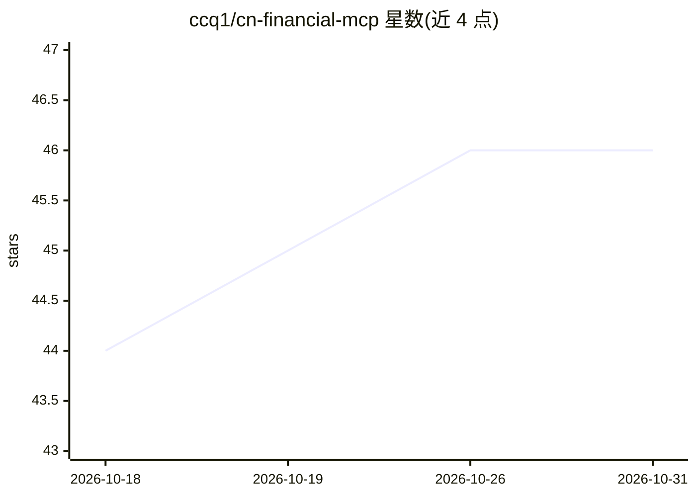

# ccq1/cn-financial-mcp

⭐ 46 · Python · Apache-2.0 · 推送 2026-03-15 · [GitHub](https://github.com/ccq1/cn-financial-mcp) · 个人维护 · 中文 README

**面向 MCP AI Agent 的中国 A 股金融数据工具服务器**

遵循 Model Context Protocol (MCP) 标准的金融数据服务器，专注中国大陆市场，让 Claude Code、Cursor 等支持 MCP 的 AI Agent 直接调用 42 个金融工具，覆盖 A 股行情、财报、估值、行业板块、市场总览、新闻公告及宏观经济指标。底层数据来源为 AKShare，无需 API Key，内置东方财富→新浪/腾讯/同花顺的多数据源自动 fallback。支持 stdio、HTTP/SSE 与 Docker 三种部署方式，要求 Python 3.10+。

## 筛选速览

| 维度 | 判定 | 备注 |
|---|---|---|
| AI 角色 | `ai-ecosystem` | LLM/agent 周边工具 |
| 许可风险 | `permissive` | Apache-2.0 |
| 部署形态 | `self-host` | docker 或自建部署 |
| 模型依赖 | — | README 未给出锁定关系 |
| 硬件要求 | — | 无带数字的原话,不猜 |
| 安装摩擦 | `low` | 无编译、无系统依赖或容器化 |
| 成熟度 | — | 结构信号不足 |

## 能力要点

- 42 个金融工具，覆盖个股到宏观的完整链路
- 多数据源自动 fallback（东方财富→新浪/腾讯/同花顺）
- stdio / HTTP/SSE / Docker 三种部署方式
- 无需 API Key，基于 AKShare 开源数据

## 适用场景

- 在 Claude Code 或 Cursor 中直接查询 A 股行情与财报
- 为自定义 AI Agent 接入中国金融数据能力
- 获取北向资金、龙虎榜等市场总览与宏观数据

## 场景标签

`金融量化` · 领域:学习与行业

## 证据(README 行号)

> L21: **cn-financial-mcp** 是一个遵循 Model Context Protocol (MCP) 标准的金融数据服务器，专注于cn大陆市场。它让任何支持 MCP 的 AI Agent（如 Claude Code、Cu
> L23: 底层数据来源于 AKShare，并内置多数据源自动 fallback 机制（东方财富 → 新浪 / 腾讯 / 同花顺），确保在不同网络环境下的可用性。

## 星数曲线

2026-10-18 44 → 2026-10-31 46（+2）

---
*卡片 v1 · prompt 1.4 · 生成 2026-10-25 · 置信度 mid · 依据 README sha `acfd979d62ba` · [字段定义](../../DATASET.md)*
