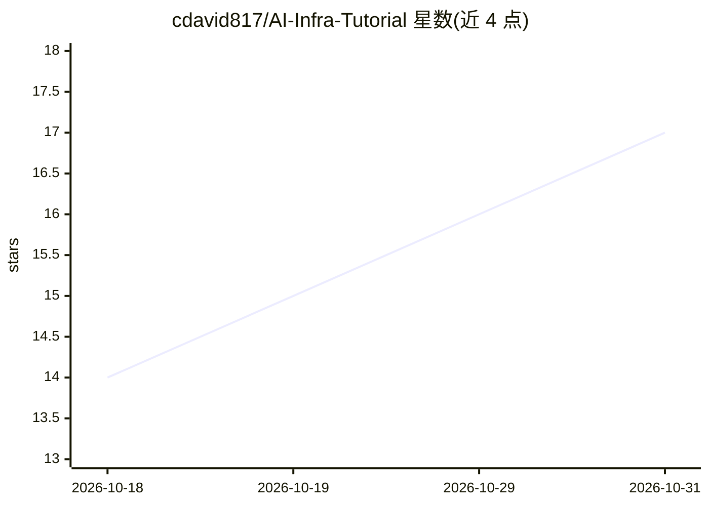

# cdavid817/AI-Infra-Tutorial

⭐ 17 · JavaScript · MIT · 推送 2026-09-02 · [GitHub](https://github.com/cdavid817/AI-Infra-Tutorial) · 个人维护 · 中文 README

**面向平台建设方的中文 AI 基础设施书稿（31 章+附录+估算器）**

一本开源中文书稿，覆盖从硬件、算力调度、数据底座、训练系统、推理系统到平台治理的 AI 基础设施全栈知识，面向自建自运维 AI 基础设施的平台建设方及 FAE/解决方案架构师等选型人员。采用分部按抽象层组织、训练与推理两条主线贯穿；每章含能力维度检查与可验证交付物，附录含数据速查表（标注数据日期）。配套 11 个分层 Labs、12 个故障 Runbooks、7 档参考架构及七个可执行估算器，支持零 GPU 环境的 Replay 学习路径。书稿 CC BY 4.0，代码 MIT。

## 筛选速览

| 维度 | 判定 | 备注 |
|---|---|---|
| AI 角色 | `ai-knowledge` | 知识聚合/清单类 |
| 许可风险 | `permissive` | MIT |
| 部署形态 | `None` |  |
| 模型依赖 | — | README 未给出锁定关系 |
| 硬件要求 | — | 无带数字的原话,不猜 |
| 安装摩擦 | `medium` | 含编译或系统依赖之一 |
| 成熟度 | — | 结构信号不足 |

## 能力要点

- 31 章正文 + 11 个附录，分层组织并以训练/推理两条主线贯穿
- 11 个分层动手实验（L0 无 GPU 至 L3 集群）与 12 个故障 Runbooks
- calculators/ 提供七个可执行估算器，公式与附录 B 双向对齐并带测试向量
- 横切概念单点定义、高时效数据集中附录并标注数据日期

## 适用场景

- 系统学习 AI 基础设施的硬件、调度、训练与推理全栈机制
- 按 QPS→卡数→功率推导链做容量规划与技术选型
- 没有 GPU/Docker 环境时通过 Replay 路径开展实验
- 训练/推理故障时按 Runbook 九段结构止损与诊断

## 场景标签

`教程课程` · 领域:学习与行业

## 证据(README 行号)

> L3: > 本书教的是:**如何让算法同事定下来的方案跑得起来、跑得快、跑得省、跑得稳。**
> L5: > 面向两类读者:自建自运维 AI 基础设施的**平台建设方**(不假定算法背景,第 3 章负责补齐),以及 FAE / 解决方案架构师 / 售前 / 采购评估等**方案与选型方**(重点看第 4、12、31 章)。
> L25: **分层为骨 + 两条主线为脉**:分部按抽象层划分(基础认知 → 硬件 → 资源 → 数据 → 训练 → 推理 → 平台 → 治理),全书用两条主线穿透各层——

## 星数曲线

2026-10-18 14 → 2026-10-31 17（+3）

---
*卡片 v1 · prompt 1.4 · 生成 2026-10-30 · 置信度 high · 依据 README sha `60b8d65d6d98` · [字段定义](../../DATASET.md)*
