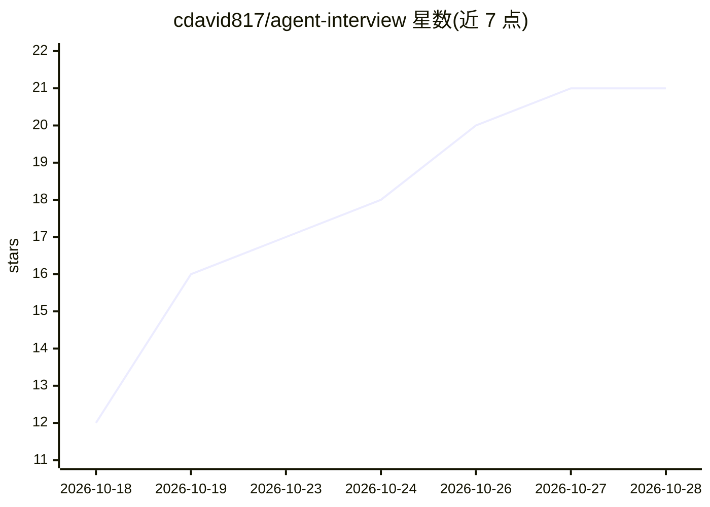

# cdavid817/agent-interview

⭐ 22 · Python · MIT · 推送 2026-08-31 · [GitHub](https://github.com/cdavid817/agent-interview) · 个人维护 · 中文 README

**AI Agent/LLM 应用工程师中文面试题库：2,038 题带参考答案**

面向 AI Agent 与大模型应用工程师的中文面试题库，收录 2,038 道问题及参考答案，按领域→章节→子主题→稳定题目 ID（如 ARC-001）组织，覆盖 Agent 架构、任务规划、MCP、RAG、安全治理与可观测性等章节。提供可直接导入的 Anki 卡组（完整 1,798 张与核心 100 张），可用 Python 脚本重新生成卡组并本地校验内容。强调事实与方案分开、证据优先等答案编写原则；参考答案不替代候选人真实项目经验。

## 筛选速览

| 维度 | 判定 | 备注 |
|---|---|---|
| AI 角色 | `ai-knowledge` | 知识聚合/清单类 |
| 许可风险 | `permissive` | MIT |
| 部署形态 | `library` | 以包/库形式分发 |
| 模型依赖 | — | README 未给出锁定关系 |
| 硬件要求 | — | 无带数字的原话,不猜 |
| 安装摩擦 | `low` | 无编译、无系统依赖或容器化 |
| 成熟度 | — | 结构信号不足 |

## 能力要点

- 2,038 道问题及参考答案，稳定题目 ID 结构
- Anki 卡组可直接导入（完整版 1,798 张 + 核心 100 张）
- 提供索引构建与内容校验的 Python 脚本
- 区分官方能力、配置能力、工程建议与未来提案的内容原则

## 适用场景

- 准备 AI Agent / LLM 应用工程师面试
- 用 Anki 按领域和知识点刷题复习
- 搭建该方向的系统学习路径与术语索引

## 场景标签

`教程课程` · 领域:学习与行业

## 证据(README 行号)

> L5: 面向 **AI Agent / 大模型应用工程师** 的中文面试题库，现收录 **2,038 道问题及参考答案**。内容强调工程边界、失败处理、验证指标和生产实践。
> L43: |领域|章节|题数|

## 星数曲线

2026-10-18 12 → 2026-10-28 21（+9）

---
*卡片 v1 · prompt 1.4 · 生成 2026-10-28 · 置信度 mid · 依据 README sha `c9228b17bf92` · [字段定义](../../DATASET.md)*
