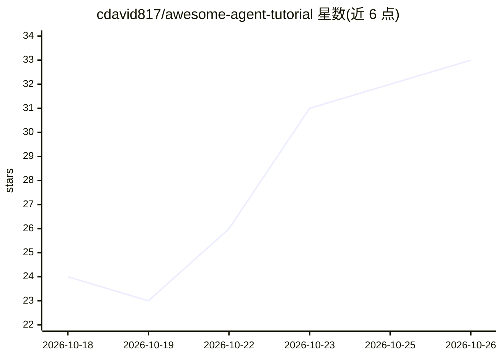

# cdavid817/awesome-agent-tutorial

⭐ 33 · Python · NOASSERTION · 推送 2026-10-12 · [GitHub](https://github.com/cdavid817/awesome-agent-tutorial) · 个人维护 · 中文 README

**面向转型工程师的企业级 Agent 工程化中文教程（27 章+贯穿项目）**

一本结构化中文教程：七篇 27 章从最小 ReAct 循环（约 150 行）增量构建具备安全、观测、评测、成本四件套的完整 Agent 系统，覆盖单/多 Agent 机制、企业落地、Coding Agent 与前沿方向；附录两层含 20 本全文收录资料（各赛道地图与四册源码解剖）。配套 Python 贯穿项目（≥3.10，唯一硬依赖 requests），代码经真实测试；仓库一致性由 make verify 与 GitHub Actions 八道门禁保证，包括章节代码与项目源码逐字符一致校验。许可证分离：代码 MIT、正文 CC BY 4.0。

## 筛选速览

| 维度 | 判定 | 备注 |
|---|---|---|
| AI 角色 | `ai-knowledge` | 知识聚合/清单类 |
| 许可风险 | `none` | NOASSERTION |
| 部署形态 | `None` |  |
| 模型依赖 | — | README 未给出锁定关系 |
| 硬件要求 | — | 无带数字的原话,不猜 |
| 安装摩擦 | `low` | 无编译、无系统依赖或容器化 |
| 成熟度 | `idea` | |

## 能力要点

- 27 章主线 + 两层附录（6 本工具书 + 20 本全文收录资料）
- 贯穿项目从 150 行长成四层十六模块，代码经真实测试
- make verify 七道门禁 + CI 八个 job 保证书稿与代码一致
- 附录含四册 Coding Agent 源码解剖（Pi/Claude Code/Codex/OpenCode）

## 适用场景

- 后端/大数据工程师系统学习 Agent 工程化转型路径
- 按决策者路线快速掌握 Agent 选型与落地评审要点
- 用贯穿项目代码作为企业 Agent 参考实现起点
- 查阅各赛道全景地图（观测/评测/记忆/MCP/沙箱/RAG 等）做选型调研

## 场景标签

`教程课程` · 领域:学习与行业

## 证据(README 行号)

> L3: > 面向有后端/大数据经验、正在转型 Agent 方向的工程师。
> L5: > 全书七篇 · 27 章 · 附录两层（附录 1–6 审读态工具书 + 附录 7–30 全文收录资料层，新增顺延编号）· 附贯穿实战项目 **示例助手**（Python 实现，全部代码经真实测试可运行）。
> L154: 企业运维/客服场景的 Agent 参考实现（Python ≥ 3.10，唯一硬依赖 `requests`），从第 2 章约 150 行长成四层十六模块。模块地图与教学简化清单见第 27 章第 3 节的项目 README——**它

## 星数曲线

2026-10-18 24 → 2026-10-26 33（+9）

---
*卡片 v1 · prompt 1.4 · 生成 2026-10-25 · 置信度 high · 依据 README sha `46c2269b7f41` · [字段定义](../../DATASET.md)*
