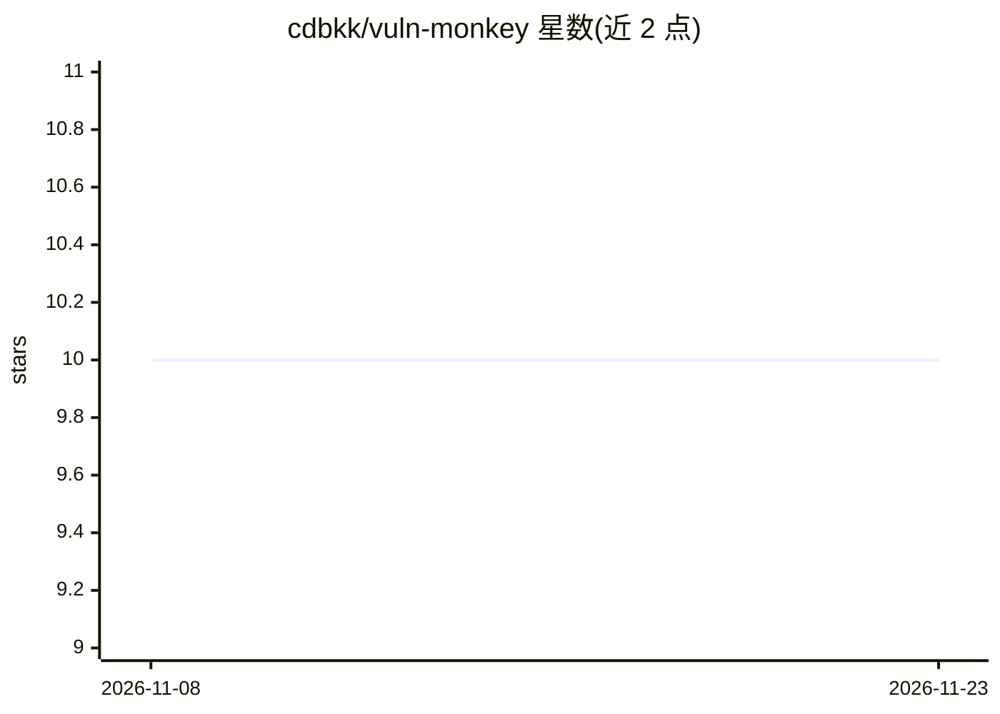

# cdbkk/vuln-monkey

⭐ 10 · TypeScript · MIT · 推送 2026-11-10 · [GitHub](https://github.com/cdbkk/vuln-monkey) · 个人维护

**API 安全模糊测试工具：用 LLM 发现端点逻辑漏洞**

面向 API 安全测试的 CLI 工具：读取 curl 命令或 OpenAPI/Swagger JSON 规范解析端点，由 LLM 分析潜在漏洞类型并生成攻击 payload，同源发射请求后分类响应，输出终端摘要与 Markdown/JSON 报告（含 0–100 风险评分）。支持 claude-cli/gemini-cli/codex-cli 等 CLI 后端与 Anthropic/OpenAI 兼容 API 后端，也可接 Ollama、LM Studio、vLLM、llama.cpp 等本地服务。内置 SSRF 防护、DNS pinning、私网地址默认拦截与凭据脱敏。结果为 LLM 驱动，需人工复核。

## 筛选速览

| 维度 | 判定 | 备注 |
|---|---|---|
| AI 角色 | `ai-native` | 本体是模型或模型工具 |
| 许可风险 | `permissive` | MIT |
| 部署形态 | `library` | 以包/库形式分发 |
| 模型依赖 | local-ok | 支持本地模型 |
| 硬件要求 | — | 无带数字的原话,不猜 |
| 安装摩擦 | `low` | 无编译、无系统依赖或容器化 |
| 成熟度 | — | 结构信号不足 |

## 能力要点

- curl 命令或 OpenAPI JSON 两种输入方式，批量模糊测试端点
- 多后端：CLI 后端免 API key，API 后端经环境变量接入，含本地 OpenAI 兼容服务
- SSRF 防护（DNS pinning、同源限制、私网默认拦截）与凭据脱敏
- --fail-on 按严重级别设退出码，JSON 报告可接入 CI

## 适用场景

- 对自有 API 端点做授权范围内的漏洞模糊测试
- 从 OpenAPI JSON 规范批量扫描所有端点
- 在 CI 流水线中按 --fail-on high 对安全扫描结果设置退出码

## 场景标签

`网络安全` · 领域:学习与行业

## 证据(README 行号)

> L10: vuln-monkey uses an LLM to analyze API endpoints, generate attack payloads, fire them, and classify the responses. 
> L126: 2. **Analyze** — LLM suggests potential vulnerability types for each endpoint.
> L127: 3. **Generate payloads** — LLM builds attack requests; if generation fails or returns nothing, a built-in fallback

## 星数曲线

2026-11-08 10 → 2026-11-23 10（+0）

---
*卡片 v1 · prompt 1.4 · 生成 2026-11-19 · 置信度 high · 依据 README sha `8388c7c6a5fe` · [字段定义](../../DATASET.md)*
