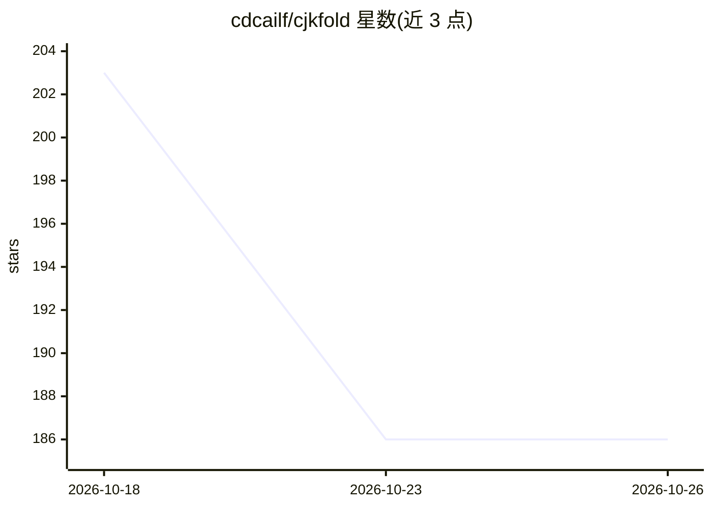

# cdcailf/cjkfold

⭐ 186 · Python · MIT · 推送 2026-10-15 · [GitHub](https://github.com/cdcailf/cjkfold) · 个人维护 · 中文 README

**折叠 PDF 提取中文里的形近异码字符，让文本重新可匹配**

纯 Python 字符归一化库（零运行时依赖，Python 3.9+），解决 PDF 抽取文本中康熙部首与 CJK 部首补充区的形近异码字符问题：NFKC 对补充区 115 字符只能修复 2 个，本库基于 UCD 的 EquivalentUnifiedIdeograph 属性修复 114 个。另提供 check/scan 命令行检测（含零宽字符、U+FFFD、私用区）、exact_boost 检索加成与 LangChain/LlamaIndex 兼容的 fold_documents/rerank。限制：不做简繁转换，已入库文本不会回溯修复。

## 筛选速览

| 维度 | 判定 | 备注 |
|---|---|---|
| AI 角色 | `ai-enhanced` | 去掉 AI 部分产品仍成立 |
| 许可风险 | `permissive` | MIT |
| 部署形态 | `library` | 以包/库形式分发 |
| 模型依赖 | — | README 未给出锁定关系 |
| 硬件要求 | — | 无带数字的原话,不猜 |
| 安装摩擦 | `low` | 无编译、无系统依赖或容器化 |
| 成熟度 | — | 结构信号不足 |

## 能力要点

- 基于 Unicode 15.1+ EquivalentUnifiedIdeograph 属性，补充区 115 字符修复 114 个
- check/scan 命令行检测四类字符问题并标注处置建议（fold/nfkc/strip/manual）
- exact_boost 将查询逐字命中补进向量相似度评分
- 零运行时依赖，三个写操作各管一族字符且幂等

## 适用场景

- 修复 PDF 抽取中文后关键词搜索、去重、缓存失效的问题
- 把 cjkfold check 接入入库流水线，在进入索引前拦截抽取回归
- 向量检索中对查询与文档两侧统一折叠后提升命中排名

## 场景标签

`RAG` · 领域:知识与检索

## 证据(README 行号)

> L194: Drop `cjkfold check` into an ingest pipeline to catch extraction regressions
> L199: Folding is the fix; ranking is the follow-up. Dense retrieval is bad at literal

## 星数曲线

2026-10-18 203 → 2026-10-26 186（-17）

---
*卡片 v1 · prompt 1.4 · 生成 2026-10-22 · 置信度 high · 依据 README sha `58d6f4f83e50` · [字段定义](../../DATASET.md)*
