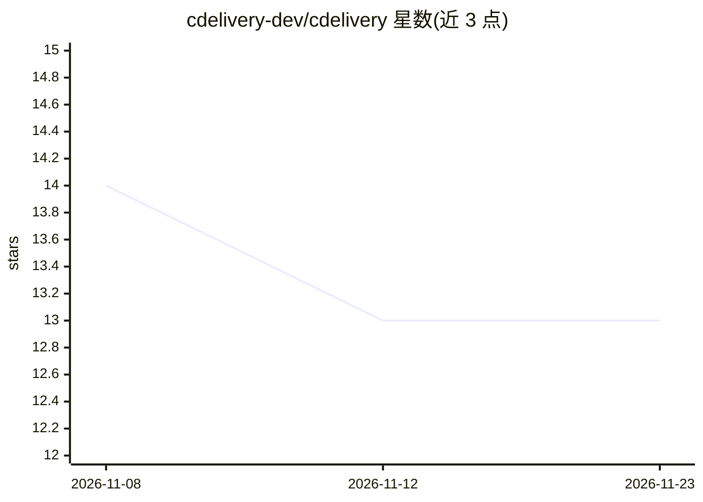

# cdelivery-dev/cdelivery

⭐ 13 · Rust · Apache-2.0 · 推送 2026-11-21 · [GitHub](https://github.com/cdelivery-dev/cdelivery) · [官网](https://cdelivery.dev) · 组织维护 · 中文 README

**自托管部署运维平台，附带 AI 诊断与主动检查**

用 Rust 编写的轻量自托管运维平台，部署与管理自有服务器上的容器化应用：应用部署与扩缩、Guardian 候选发布校验与 XHealth 工作流检查、Insight 日志与指标采集查询、Pingress 反向代理与 HTTPS 证书管理、XConfig 配置分发与 XJob 定时任务。AI 部分为可配置模型提供方的诊断与主动检查功能，操作受角色权限限制，并支持通过 MCP 与 REST 接入外部工具。核心服务低负载内存占用 50 MiB，通过安装脚本部署。

## 筛选速览

| 维度 | 判定 | 备注 |
|---|---|---|
| AI 角色 | `ai-enhanced` | 去掉 AI 部分产品仍成立 |
| 许可风险 | `permissive` | Apache-2.0 |
| 部署形态 | `None` |  |
| 模型依赖 | — | README 未给出锁定关系 |
| 硬件要求 | — | 无带数字的原话,不猜 |
| 安装摩擦 | `low` | 无编译、无系统依赖或容器化 |
| 成熟度 | — | 结构信号不足 |

## 能力要点

- 容器化应用部署、扩缩与多机管理
- Guardian 发布前校验，检查失败即阻止晋级
- Insight 日志/指标采集与 Pingress 网关及证书自动管理
- 可配置模型提供方的 AI 诊断与主动检查，支持 MCP/REST 接入

## 适用场景

- 在自己的服务器上自托管部署与运维容器应用
- 发布前对候选版本做自动化健康校验
- 集中采集与查询应用日志、指标与网关访问记录
- 用 AI 辅助运维诊断与主动巡检

## 场景标签

 · 领域:DevOps/部署运维平台

## 证据(README 行号)

> L5:  A lightweight, self-hosted operations platform for deploying and running applications on your own servers.
> L19: - **AI operations.** Configure a model provider for AI diagnostics and proactive checks, with actions limited by th

## 星数曲线

2026-11-08 14 → 2026-11-23 13（-1）

---
*卡片 v1 · prompt 1.4 · 生成 2026-11-18 · 置信度 high · 依据 README sha `d515a5d6625f` · [字段定义](../../DATASET.md)*
