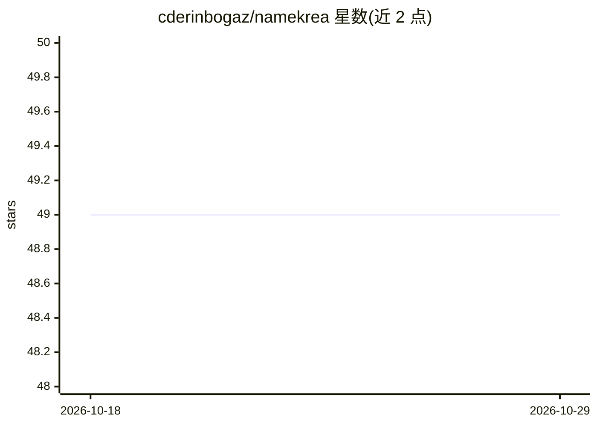

# cderinbogaz/namekrea

⭐ 49 · Python · MIT · 推送 2026-03-05 · [GitHub](https://github.com/cderinbogaz/namekrea) · [官网](https://namekrea.com) · 个人维护

**基于 GPT-2 微调的域名生成模型与训练管线**

个人深度学习项目：抓取 Majestic Million 前 100 万域名清单中约 10 万个网站的域名与元描述文本，用 model_trainer.py 微调 GPT-2 355M 参数模型，使其根据给定网站内容上下文生成域名；text_generator.py 脚本用训练后的模型生成结果，scraper.py 负责数据抓取并过滤非英文内容。README 记录训练依赖 GPU（作者用 2×1070Ti 约 30 分钟），无 GPU 训练耗时显著更长。附带 Medium 文章与在线站点 namekrea.com。

## 筛选速览

| 维度 | 判定 | 备注 |
|---|---|---|
| AI 角色 | `ai-native` | 本体是模型或模型工具 |
| 许可风险 | `permissive` | MIT |
| 部署形态 | `None` |  |
| 模型依赖 | — | README 未给出锁定关系 |
| 硬件要求 | — | 无带数字的原话,不猜 |
| 安装摩擦 | `low` | 无编译、无系统依赖或容器化 |
| 成熟度 | — | 结构信号不足 |

## 能力要点

- 抓取约 10 万网站的域名与元描述构建训练数据
- 微调 GPT-2 355M 参数模型学习域名与站点内容的关联
- 提供 scraper.py / model_trainer.py / text_generator.py 三段式流程

## 适用场景

- 根据网站业务描述生成候选域名
- 复用其管线微调 GPT-2 做文本生成实验
- 学习 GPT-2 在命名任务上的微调方法

## 场景标签

`微调` · 领域:训练与推理

## 证据(README 行号)

> L4: Namekrea is an deep learning model which is able to
> L12: creative text generation. Therefore I created NameKrea.com which is an AI that generates domain names. Domain name 
> L49: When training is done you will have your working model under the models directory. Use the model under this directo

## 星数曲线

2026-10-18 49 → 2026-10-29 49（+0）

---
*卡片 v1 · prompt 1.4 · 生成 2026-10-24 · 置信度 high · 依据 README sha `19040053a582` · [字段定义](../../DATASET.md)*
