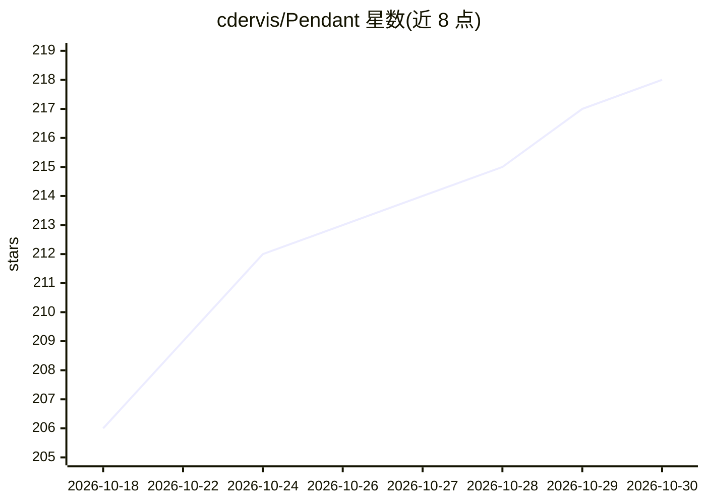

# cdervis/Pendant

⭐ 218 · 推送 2026-09-20 · [GitHub](https://github.com/cdervis/Pendant) · [官网](https://pendant.sh) · 个人维护

**把 Pi 编码 agent 嵌入 VS Code 的侧边栏扩展**

VS Code 扩展，将 Pi coding agent 以侧边栏和编辑器标签页形式集成：直接调用 Pi，读取其配置、扩展、技能与提示词，支持用户 Pi 环境中可用的所有模型（含本地模型）。功能包括附加文件/选区/诊断/图片/Git 状态作为编辑器上下文、流式工具与 diff/Mermaid/MathJax 等富输出、可固定/搜索/分叉的持久会话、基于 whisper.cpp 的本地语音听写，可搭配本地模型离线工作；不添加托管代理与遥测。兼容 VS Code、VSCodium 及兼容编辑器，桌面版尚未发布。

## 筛选速览

| 维度 | 判定 | 备注 |
|---|---|---|
| AI 角色 | `ai-ecosystem` | LLM/agent 周边工具 |
| 许可风险 | `none` | — |
| 部署形态 | `None` |  |
| 模型依赖 | — | README 未给出锁定关系 |
| 硬件要求 | — | 无带数字的原话,不猜 |
| 安装摩擦 | `low` | 无编译、无系统依赖或容器化 |
| 成熟度 | — | 结构信号不足 |

## 能力要点

- 直接使用 Pi 配置与其支持的全部模型（本地到托管模型）
- 附加文件、选区、诊断、图片、Git 状态等编辑器上下文
- 基于 whisper.cpp 的本地语音听写与离线工作能力
- 无托管代理、无遥测、无远程崩溃上报

## 适用场景

- 在 VS Code 内以侧边栏方式使用 Pi coding agent 编码
- 搭配本地模型在无网络环境下工作
- 管理、搜索与分叉 agent 会话

## 场景标签

`编码 Agent` `语音识别` · 领域:编码与开发

## 证据(README 行号)

> L5: ### The Pi coding agent, built into VS Code.
> L9: Pendant brings Pi into VS Code as a focused, lightweight sidebar and editor tabs. It uses Pi directly, loads your co

## 星数曲线

2026-10-18 206 → 2026-10-30 218（+12）

---
*卡片 v1 · prompt 1.4 · 生成 2026-10-22 · 置信度 high · 依据 README sha `df19c66954be` · [字段定义](../../DATASET.md)*
