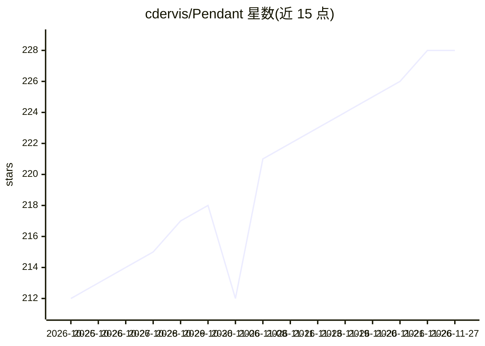

# cdervis/Pendant

⭐ 228 · 推送 2026-11-18 · [GitHub](https://github.com/cdervis/Pendant) · [官网](https://pendant.sh) · 个人维护

**Pi 编码 agent 的桌面工作台：聊天/会话/文件/编辑一体化**

面向 Pi coding agent 社区的桌面应用，将 Pi 置于聚焦工作台中，整合聊天、会话、文件与编辑器工具。Pi 内置于应用，无需单独安装 Pi 或 Node；沿用用户既有的配置、扩展、技能、提示词与模型。提供编辑器上下文附加（文件/选区/诊断）、编辑 diff 实时展示、语言服务器驱动的代码导航、Pi 扩展界面渲染、子代理运行跟踪，以及基于 whisper.cpp 的本地语音输入与本地模型离线运行。另有 VS Code 与 Open VSX 版本。

## 筛选速览

| 维度 | 判定 | 备注 |
|---|---|---|
| AI 角色 | `ai-ecosystem` | LLM/agent 周边工具 |
| 许可风险 | `none` | — |
| 部署形态 | `None` |  |
| 模型依赖 | — | README 未给出锁定关系 |
| 硬件要求 | — | 无带数字的原话,不猜 |
| 安装摩擦 | `low` | 无编译、无系统依赖或容器化 |
| 成熟度 | — | 结构信号不足 |

## 能力要点

- Pi 内置，无需单独安装 Pi 或 Node
- 编辑以 diff 形式实时显示在文件中
- 通过语言服务器提供代码导航（定义/引用/符号）
- whisper.cpp 本地语音输入，支持本地模型离线运行

## 适用场景

- 在桌面工作台中运行 Pi coding agent 完成编码任务
- 附加文件与诊断作为 agent 上下文，避免复制粘贴
- 离线环境下配合本地模型使用编码助手
- 逐步跟踪 subagent 的执行过程

## 场景标签

`编码 Agent` · 领域:编码与开发

## 证据(README 行号)

> L5:  Pendant brings the Pi coding agent to a focused workspace, with chat, sessions, files, and editor tools in one plac
> L7:  It runs Pi directly and uses your existing configuration, extensions, skills, prompts, and models.

## 星数曲线

2026-10-25 212 → 2026-11-27 228（+16）

---
*卡片 v1 · prompt 1.4 · 生成 2026-11-25 · 置信度 high · 依据 README sha `0c1862bb43f0` · [字段定义](../../DATASET.md)*
