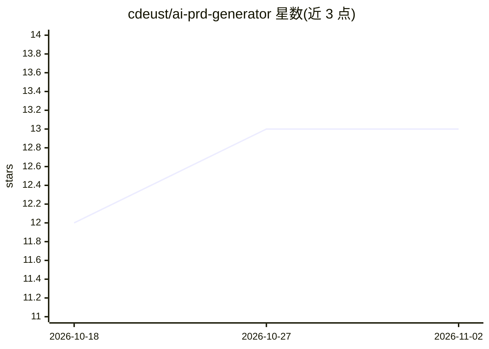

# cdeust/ai-prd-generator

⭐ 13 · Swift · NOASSERTION · 推送 2026-02-19 · [GitHub](https://github.com/cdeust/ai-prd-generator) · 个人维护

**面向 Claude Code/Cowork 的 PRD 生成插件，多 LLM 逐条核验**

运行在 Claude Code CLI 与 Cowork 桌面端的插件：通过多轮交互式澄清提问（置信度达 92-95% 以上）分析项目描述与可选的代码库索引，生成 4 文件交付物——PRD 文档、带斐波那契故事点的 JIRA 工单、覆盖单元/集成/e2e 的测试用例，以及逐条声明的核验报告。支持 8 种 PRD 类型、15 种思维策略、6 种多裁判核验算法。分免费层与许可证层：免费层限 Feature/Bug 类型、2 种策略、3 轮澄清。安装需 Node.js 18+，通过 git clone 与 setup.sh 脚本完成。

## 筛选速览

| 维度 | 判定 | 备注 |
|---|---|---|
| AI 角色 | `ai-native` | 本体是模型或模型工具 |
| 许可风险 | `none` | NOASSERTION |
| 部署形态 | `None` |  |
| 模型依赖 | locked-api |  |
| 硬件要求 | — | 无带数字的原话,不猜 |
| 安装摩擦 | `low` | 无编译、无系统依赖或容器化 |
| 成熟度 | — | 结构信号不足 |

## 能力要点

- 多轮澄清工作流直至置信度 92-95%+，输出 4 文件交付物
- 逐条声明核验报告，含 6 种核验算法与置信度评分
- 代码库上下文分析：提取架构模式、领域实体并在 PRD 中引用具体文件行号
- 8 种 PRD 类型与 15 种来自研究论文的思维策略

## 适用场景

- 为新功能或系统生成含 API 规格与 SQL DDL 的完整 PRD
- 基于现有代码库架构生成上下文相关的需求文档
- 从 PRD 直接产出 JIRA 工单与带追溯矩阵的测试用例

## 场景标签

`AI 写作` · 领域:内容生成

## 证据(README 行号)

> L3: Generate implementation-ready Product Requirements Documents with SQL DDL, API specs, domain models, JIRA tickets, t
> L7: This plugin generates enterprise-grade PRDs through an interactive multi-round clarification workflow. It analyzes y
> L79: Requires Node.js 18+ and Claude Code.

## 星数曲线

2026-10-18 12 → 2026-11-02 13（+1）

---
*卡片 v1 · prompt 1.4 · 生成 2026-10-31 · 置信度 high · 依据 README sha `5bdc10cd8379` · [字段定义](../../DATASET.md)*
