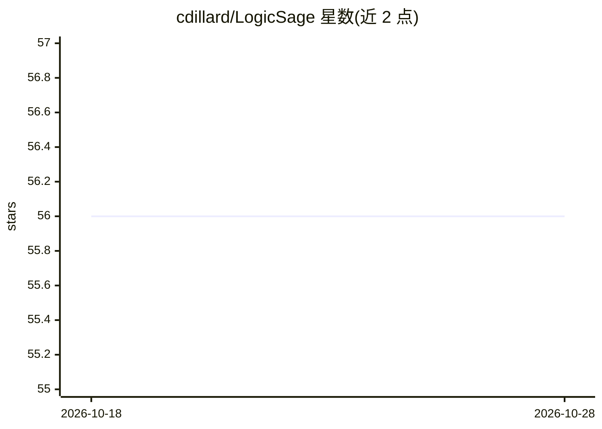

# cdillard/LogicSage

⭐ 56 · Swift · MIT · 推送 2026-02-16 · [GitHub](https://github.com/cdillard/LogicSage) · [官网](https://apps.apple.com/us/app/logicsage/id6448485441) · 个人维护

**苹果平台的 AI 代码与聊天客户端，自带 API Key 调用 GPT**

SwiftUI 编写的 iOS/iPadOS/macOS/visionOS 应用，通过用户自备的 OpenAI API Key 进行 GPT 聊天与代码片段复制；Key 存储于设备钥匙串，仅在请求 OpenAI 时使用。可选集成 Google Custom Search 使 GPT 回答纳入搜索结果（需在设置中填入 Key，切换到 gpt-4-1106-web-browsing* 模型）。Mac 端配套 LogicSageCommandLine 中间件，可从设备远程调用命令、打开/构建/运行 AI 生成的 Xcode 项目（标注 Work in Progress）。iOS 端从 App Store 免费下载；Mac 命令行部分需 Homebrew、Ruby、Xcode、XcodeGen 等依赖并从源码构建。README 提示 token 费用由用户自行承担。

## 筛选速览

| 维度 | 判定 | 备注 |
|---|---|---|
| AI 角色 | `ai-native` | 本体是模型或模型工具 |
| 许可风险 | `permissive` | MIT |
| 部署形态 | `None` |  |
| 模型依赖 | — | README 未给出锁定关系 |
| 硬件要求 | — | 无带数字的原话,不猜 |
| 安装摩擦 | `low` | 无编译、无系统依赖或容器化 |
| 成熟度 | `idea` | |

## 能力要点

- BYOK 模式：API Key 存于设备钥匙串，仅请求 OpenAI 时使用
- 可选 Google Custom Search 集成，将搜索结果并入 GPT 回答
- LogicSageCommandLine 让 GPT 在 Mac 上打开/构建/测试 Xcode 项目
- 支持 visionOS/iOS/iPadOS/macOS 多平台

## 适用场景

- 在 iPad 或 iPhone 上用 GPT 聊天并复制代码片段
- 无 Mac 情况下通过 GPT 加 Google 搜索获取带检索结果的回答
- 从 iOS 设备远程构建和运行 Mac 上的 Xcode 项目

## 场景标签

`聊天机器人` `代码生成` · 领域:编码与开发

## 证据(README 行号)

> L1: # LogicSage: AI Code & Chat on Apple platforms. (iPadOS, MacOS, and iOS)
> L19: 1. LogicSage is a 'Bring Your Own API Key' app. Before you can start chatting, you need to enter an OpenAI API Key 

## 星数曲线

2026-10-18 56 → 2026-10-28 56（+0）

---
*卡片 v1 · prompt 1.4 · 生成 2026-10-24 · 置信度 high · 依据 README sha `84023e9ba15a` · [字段定义](../../DATASET.md)*
