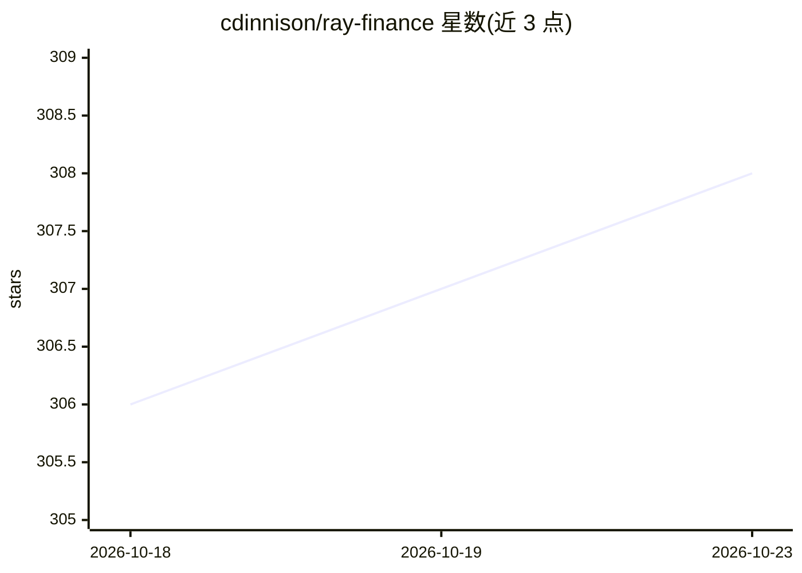

# cdinnison/ray-finance

⭐ 308 · TypeScript · MIT · 推送 2026-08-01 · [GitHub](https://github.com/cdinnison/ray-finance) · [官网](https://rayfinance.app) · 个人维护

**开源本地优先的 AI 个人财务顾问 CLI**

面向个人用户的命令行 AI 财务顾问：通过 Plaid（美/加）或 Bridge（欧洲）同步银行账户，数据存储在本机 AES-256 加密的 SQLite 数据库中，发送给 AI 前对 PII 做脱敏。对话基于用户财务画像（家庭、收入、目标）生成具体建议，支持长期记忆与自动更新画像；另提供预算、目标追踪、每日行为评分与告警。AI 后端可选 Anthropic、OpenAI、Ollama 或任意 OpenAI 兼容端点；提供每月 $10 的托管 API key 模式或自带 key 免费使用。

## 筛选速览

| 维度 | 判定 | 备注 |
|---|---|---|
| AI 角色 | `ai-native` | 本体是模型或模型工具 |
| 许可风险 | `permissive` | MIT |
| 部署形态 | `library` | 以包/库形式分发 |
| 模型依赖 | local-ok | 支持本地模型 |
| 硬件要求 | — | 无带数字的原话,不猜 |
| 安装摩擦 | `low` | 无编译、无系统依赖或容器化 |
| 成熟度 | — | 结构信号不足 |

## 能力要点

- Plaid/Bridge 银行同步，数据仅存本机 AES-256 加密数据库
- PII 脱敏后才调用 AI 提供商，无遥测
- 自更新财务画像与跨对话长期记忆
- 支持 Anthropic/OpenAI/Ollama/OpenAI 兼容端点，含演示假数据模式

## 适用场景

- 基于真实银行数据获得具体财务决策建议
- 追踪预算、目标、账单与消费分类
- 用假数据试用后再连接真实账户

## 场景标签

 · 领域:个人理财/fintech

## 证据(README 行号)

> L15: Tell Ray about your family, goals, and strategy once. From then on, every answer is a real recommendation grounded 
> L150: Two outbound calls: your bank aggregator (Plaid or Bridge) and your AI provider (PII-masked). Supports Anthropic, 

## 星数曲线

2026-10-18 306 → 2026-10-23 308（+2）

---
*卡片 v1 · prompt 1.4 · 生成 2026-10-21 · 置信度 high · 依据 README sha `f51ab799ac25` · [字段定义](../../DATASET.md)*
