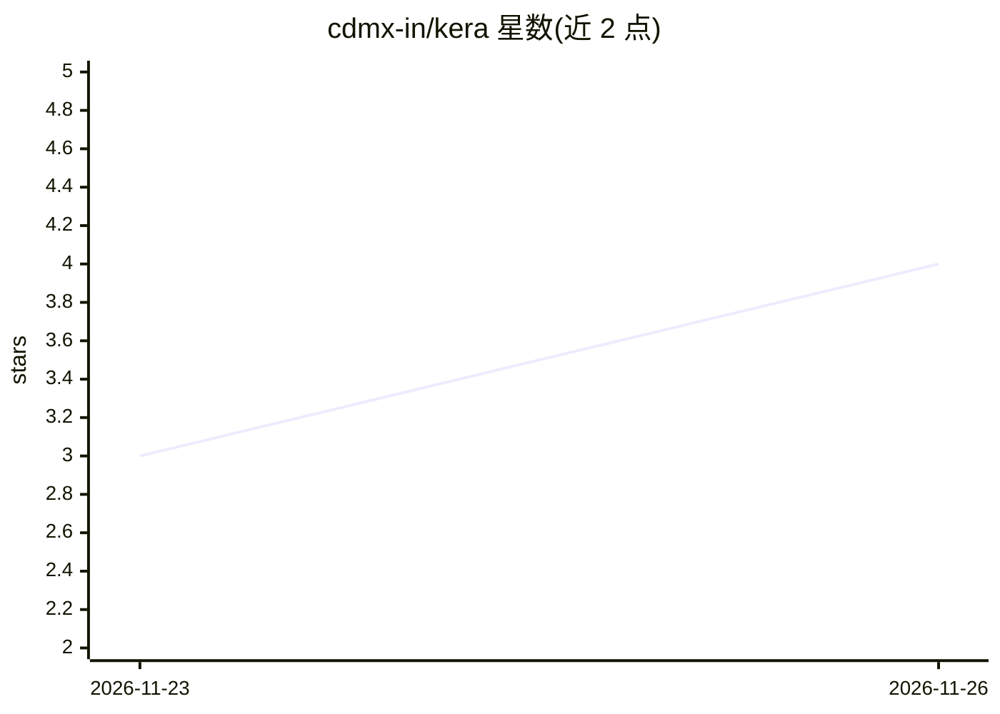

# cdmx-in/kera

⭐ 4 · Go · Apache-2.0 · 推送 2026-11-25 · [GitHub](https://github.com/cdmx-in/kera) · [官网](https://cdmx.in) · 组织维护

**自托管团队 AI 聊天平台：一个 Go 二进制加 Postgres**

面向团队的自托管 AI 聊天服务：单个 Go 二进制内嵌 Web 应用，以 Postgres 18 + pgvector 作为唯一必需依赖，存储用户、会话、文件元数据、向量与全文索引。功能覆盖流式聊天、OIDC 登录与团队权限、可配置的助手预设、混合检索知识库、OpenAPI/MCP 工具服务器、Jupyter 沙箱代码解释器、沙箱桌面任务模式，以及每次模型调用前的 PII 脱敏、注入检测、屏蔽词与审核等守卫检查并留存审计事件。部署用 Docker Compose，也可从源码构建。

## 筛选速览

| 维度 | 判定 | 备注 |
|---|---|---|
| AI 角色 | `ai-native` | 本体是模型或模型工具 |
| 许可风险 | `permissive` | Apache-2.0 |
| 部署形态 | `self-host` | docker 或自建部署 |
| 模型依赖 | local-ok | 支持本地模型 |
| 硬件要求 | — | 无带数字的原话,不猜 |
| 安装摩擦 | `low` | 无编译、无系统依赖或容器化 |
| 成熟度 | — | 结构信号不足 |

## 能力要点

- 单二进制 + ~28 MB 容器镜像，Postgres+pgvector 为唯一必需依赖
- 每次模型调用经过 PII 脱敏/注入检测/屏蔽词/审核守卫并记录审计事件
- OpenAPI 与 MCP 工具服务器，配 Jupyter 沙箱代码解释器
- Cowork 任务模式：模型驱动沙箱 Linux 桌面，可随时接管

## 适用场景

- 团队内部自托管与本地及托管模型的统一聊天入口
- 接入公司知识库做检索问答并管控数据不出域
- 对消息与输出做 PII 脱敏和提示注入拦截的合规场景

## 场景标签

`聊天机器人` `文档问答` · 领域:对话与助手

## 证据(README 行号)

> L3: **A self-hosted AI chat for teams.** One small Go binary, Postgres only, built for Ollama and any OpenAI-compatible 
> L18: - **One dependency.** Postgres 18 with pgvector holds users, chats, file metadata, vectors and full-text indexes. Y
> L19: - **Local first.** Ollama models are first-class. Any OpenAI-compatible endpoint works too, including the Responses

## 星数曲线

2026-11-23 3 → 2026-11-26 4（+1）

---
*卡片 v1 · prompt 1.4 · 生成 2026-11-23 · 置信度 high · 依据 README sha `c013ba028c55` · [字段定义](../../DATASET.md)*
