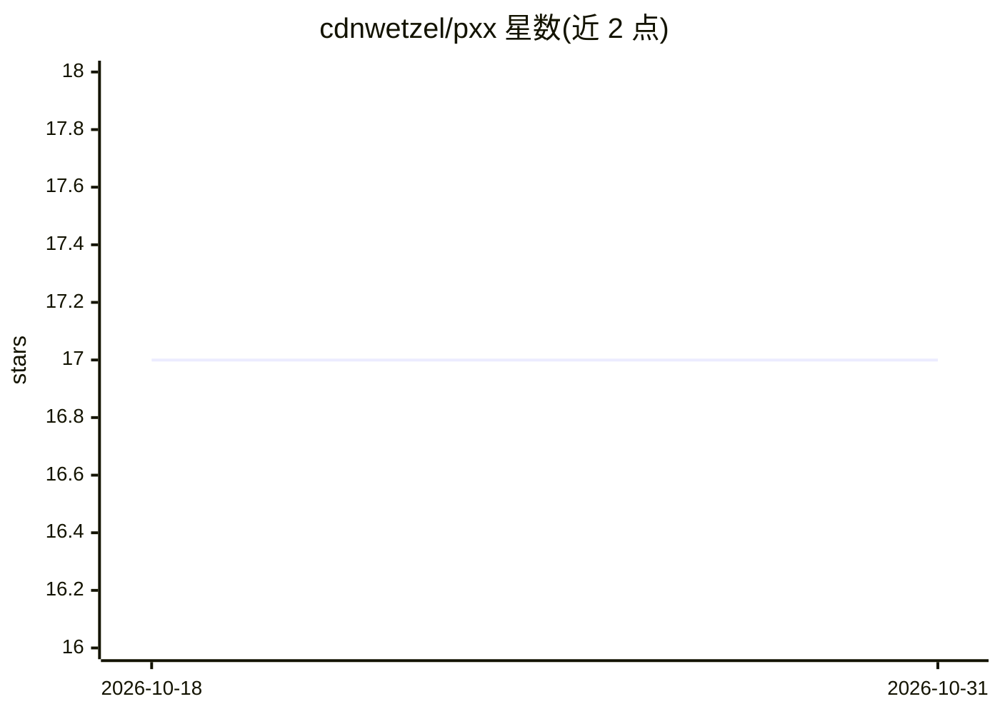

# cdnwetzel/pxx

⭐ 17 · Python · MIT · 推送 2026-10-26 · [GitHub](https://github.com/cdnwetzel/pxx) · 个人维护

**本地优先 AI 编程 agent 运行时：自托管模型+安全门控**

异步、事件溯源的编码 agent 运行时，对接用户自有的推理端点（Ollama、vLLM 或任意 OpenAI 兼容端点），无需云服务、遥测或 API key。核心机制：pxx 自持 agent 循环，主机层强制执行作用域、权限、预算与钩子（fail-closed），默认只读；持久化跨会话记忆存于本地 SQLite（BM25+向量混合检索）；哈希链审计日志可用 pxx audit verify 校验；支持 MCP 互操作，可将 aider 作为可选编辑后端。声明为 2.x 早期、单人维护。面向有自托管、主权与可审计要求的运维/开发者场景。

## 筛选速览

| 维度 | 判定 | 备注 |
|---|---|---|
| AI 角色 | `ai-ecosystem` | LLM/agent 周边工具 |
| 许可风险 | `permissive` | MIT |
| 部署形态 | `library` | 以包/库形式分发 |
| 模型依赖 | local-ok | 支持本地模型 |
| 硬件要求 | — | 无带数字的原话,不猜 |
| 安装摩擦 | `low` | 无编译、无系统依赖或容器化 |
| 成熟度 | `idea` | |

## 能力要点

- 主机层强制的作用域/权限/预算/钩子门控，默认只读，fail-closed
- 本地 SQLite 持久记忆，FTS5 BM25 + 向量余弦混合检索，离线可用
- 哈希链防篡改审计日志，pxx audit verify 可校验
- 可消费 MCP 服务器作为工具，也可将自身记忆暴露为 MCP 服务器

## 适用场景

- 在气隙/受监管环境里运行不出网的 AI 编程 agent
- 为本地模型构建带审计记录与预算限制的自动化编码任务
- 通过 MCP 将项目记忆共享给 Claude Code、goose 等其他 agent

## 场景标签

`编码 Agent` · 领域:编码与开发

## 证据(README 行号)

> L8: `pxx` is an async, event-sourced coding-agent runtime that runs against **your own
> L9: inference** (Ollama, vLLM, or any OpenAI-compatible endpoint) - no cloud dependency,
> L29: - **pxx owns the runtime**: every model/tool event flows through pxx's event bus.

## 星数曲线

2026-10-18 17 → 2026-10-31 17（+0）

---
*卡片 v1 · prompt 1.4 · 生成 2026-10-29 · 置信度 high · 依据 README sha `b543fa6689b0` · [字段定义](../../DATASET.md)*
