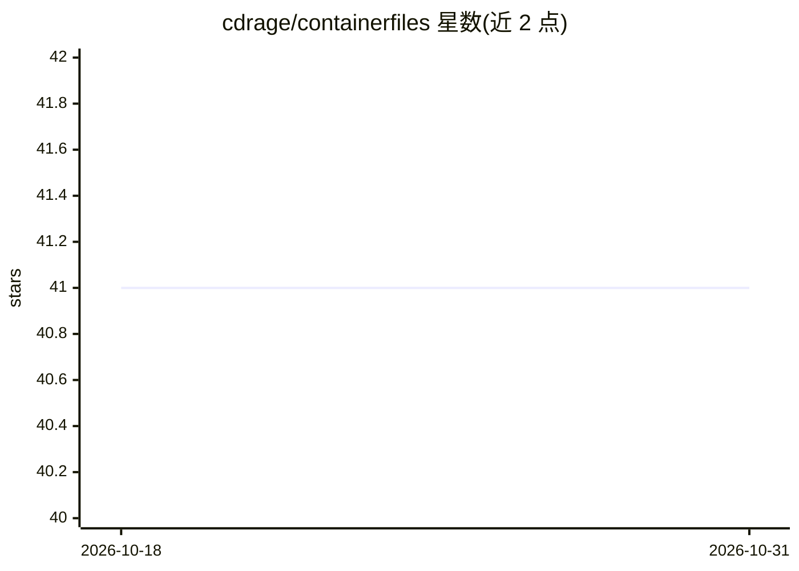

# cdrage/containerfiles

⭐ 41 · Shell · 推送 2026-10-29 · [GitHub](https://github.com/cdrage/containerfiles) · 个人维护

**个人维护的容器镜像集合：覆盖 Web、游戏服务器、bootc 系统与 AI 等服务**

作者日常使用的 Containerfile 合集，镜像推送至 ghcr.io，可用 podman/docker 运行或克隆仓库自行构建。条目包含：bootc 可引导容器（CentOS/Fedora httpd、k3s master/node、NVIDIA GPU 驱动基础镜像）、KASM 网页 VNC 桌面（Chromium、OBS）、Hugo 站点、加密日志、航空检查单生成器等。仓库主题标签含 ai/llm/stable-diffusion，但可见 README 段落未展示 AI 类条目。k3s 镜像支持传入 token、SSH 公钥、HA 部署等构建参数。

## 筛选速览

| 维度 | 判定 | 备注 |
|---|---|---|
| AI 角色 | `ai-ecosystem` | LLM/agent 周边工具 |
| 许可风险 | `none` | — |
| 部署形态 | `self-host` | docker 或自建部署 |
| 模型依赖 | — | README 未给出锁定关系 |
| 硬件要求 | — | 无带数字的原话,不猜 |
| 安装摩擦 | `low` | 无编译、无系统依赖或容器化 |
| 成熟度 | — | 结构信号不足 |

## 能力要点

- 镜像统一推送 ghcr.io，提供 podman/docker 运行命令
- bootc 系列：可引导的 httpd、k3s master/node 与 NVIDIA 驱动基础镜像
- k3s 镜像支持 K3S_TOKEN、SSH 公钥、K8S_VERSION 等构建参数与 HA 部署
- KASM 网页 VNC 方式运行 Chromium、OBS 等桌面软件

## 适用场景

- 直接拉取现成镜像快速部署个人常用服务
- 参考 Containerfile 编写自己的容器或 bootc 可引导镜像
- 搭建带 GPU 驱动的 k3s 集群基础环境

## 场景标签

 · 领域:DevOps/容器化

## 证据(README 行号)

> L10: All the Containerfiles I use.
> L18:  - You may also `git clone https://github.com/cdrage/containerfiles` and build it yourself (`podman build -t userna

## 星数曲线

2026-10-18 41 → 2026-10-31 41（+0）

---
*卡片 v1 · prompt 1.4 · 生成 2026-10-25 · 置信度 mid · 依据 README sha `71a8afbacae2` · [字段定义](../../DATASET.md)*
