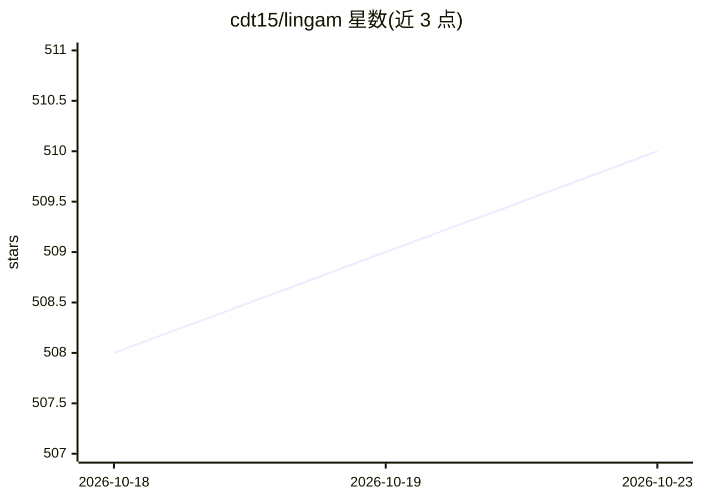

# cdt15/lingam

⭐ 510 · Python · MIT · 推送 2026-09-08 · [GitHub](https://github.com/cdt15/lingam) · [官网](https://sites.google.com/view/sshimizu06/lingam) · 组织维护

**基于非高斯数据的线性因果结构发现 Python 库**

LiNGAM 官方 Python 包，实现基于数据非高斯性的结构方程模型/线性贝叶斯网络估计，用于因果发现。实现 ICA-LiNGAM、DirectLiNGAM、VAR-LiNGAM 时间序列、多数据集、含潜变量混淆（RCD、CAM-UV、ParceLiNGAM）、混合数据（LiM）与缺失数据（Missingness-LiNGAM）等算法。以 pip 安装，依赖 numpy/scikit-learn/graphviz/statsmodels 等，提供 Jupyter Notebook 示例、文档与教程幻灯片，MIT 许可。

## 筛选速览

| 维度 | 判定 | 备注 |
|---|---|---|
| AI 角色 | `ai-native` | 本体是模型或模型工具 |
| 许可风险 | `permissive` | MIT |
| 部署形态 | `library` | 以包/库形式分发 |
| 模型依赖 | — | README 未给出锁定关系 |
| 硬件要求 | — | 无带数字的原话,不猜 |
| 安装摩擦 | `low` | 无编译、无系统依赖或容器化 |
| 成熟度 | — | 结构信号不足 |

## 能力要点

- 基于非高斯性的线性结构方程模型因果发现
- 覆盖时间序列、多组数据、纵向数据算法
- 含潜变量混淆场景的 RCD、CAM-UV、ParceLiNGAM 等算法
- 支持混合数据与缺失数据因果发现

## 适用场景

- 从观测数据估计变量间线性因果结构
- 时间序列与纵向数据的因果发现
- 存在潜变量混淆时的因果顺序估计
- 混合类型或含缺失数据的因果分析

## 场景标签

 · 领域:因果推断/机器学习

## 证据(README 行号)

> L9: LiNGAM is a new method for estimating structural equation models or linear Bayesian networks. It is based on using t
> L69: * T. Ikeuchi, M. Ide, Y. Zeng, T. N. Maeda, and S. Shimizu. **Python package for causal discovery based on LiNGAM**

## 星数曲线

2026-10-18 508 → 2026-10-23 510（+2）

---
*卡片 v1 · prompt 1.4 · 生成 2026-10-21 · 置信度 high · 依据 README sha `9c9d3ace5b81` · [字段定义](../../DATASET.md)*
