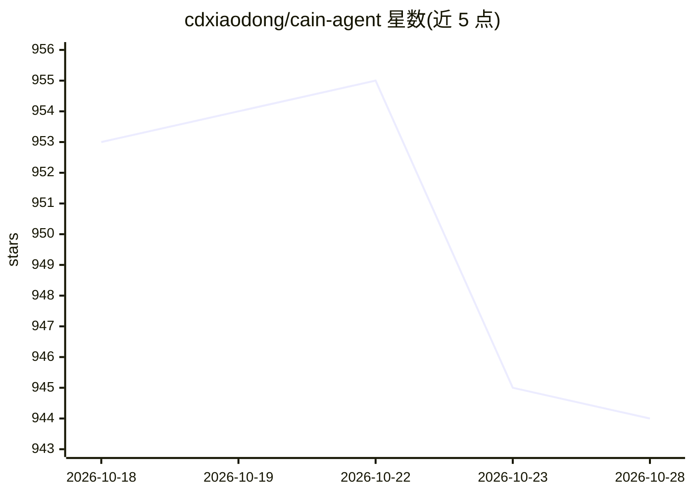

# cdxiaodong/cain-agent

⭐ 944 · Python · Apache-2.0 · 推送 2026-10-14 · [GitHub](https://github.com/cdxiaodong/cain-agent) · 个人维护 · 中文 README

**面向授权评估的 AI 渗透测试工程，含多云模块**

基于 Claude Agent SDK 构建的 AI 渗透测试工具，面向真实授权安全评估：按确定性攻击管线执行侦察/测试/报告三阶段，通过 scope.yaml 配置强制约束范围、只读工具链（46 个内置安全工具）与发现者≠验证者双会话机制保障安全。内置云渗透模块覆盖 AWS/Azure/GCP/阿里云/腾讯云/华为云的存储暴露、IAM/RAM 提权路径图分析与云元数据 SSRF。支持 claude 与 pi 两种执行后端，各阶段可分别路由模型，输出报告、JSON 汇总与验证摘要三类产物。README 自述处于积极开发中、核心 MVP 可用。

## 筛选速览

| 维度 | 判定 | 备注 |
|---|---|---|
| AI 角色 | `ai-native` | 本体是模型或模型工具 |
| 许可风险 | `permissive` | Apache-2.0 |
| 部署形态 | `library` | 以包/库形式分发 |
| 模型依赖 | locked-api |  |
| 硬件要求 | — | 无带数字的原话,不猜 |
| 安装摩擦 | `low` | 无编译、无系统依赖或容器化 |
| 成熟度 | `idea` | |

## 能力要点

- scope.yaml 配置级范围强制与只读工具链（危险操作黑名单）
- 云模块覆盖 AWS/Azure/GCP/阿里云/腾讯云/华为云存储与 IAM/RAM 提权图分析
- 发现与验证分离的双会话机制，4 态结构化判定
- 侦察/测试/报告三阶段可分别指定执行后端与模型

## 适用场景

- 对企业资产或漏洞赏金目标做授权渗透测试
- 排查多云环境的存储暴露与 IAM 提权路径
- 生成带证据链哈希与修复建议的可审计报告

## 场景标签

`网络安全` · 领域:学习与行业

## 证据(README 行号)

> L5: **Cain** is an AI penetration-testing engineer built for **real-world authorized security assessments** — not a CTF 
> L9: Built on the Claude Agent SDK.
> L25: - 🤖 **AI-Powered**: Claude Agent SDK with deterministic orchestration

## 星数曲线

2026-10-18 953 → 2026-10-28 944（-9）

---
*卡片 v1 · prompt 1.4 · 生成 2026-10-21 · 置信度 high · 依据 README sha `aa74a105c8c5` · [字段定义](../../DATASET.md)*
