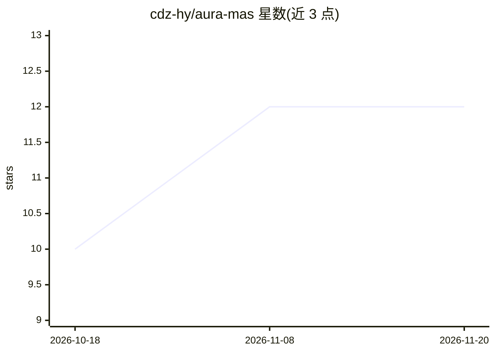

# cdz-hy/aura-mas

⭐ 12 · Python · MIT · 推送 2026-07-28 · [GitHub](https://github.com/cdz-hy/aura-mas) · 个人维护 · 中文 README

**面向学习者的多智能体个性化学习资源生成平台**

基于 LangGraph 多智能体协作的个性化学习系统，覆盖 Web 与 Android 双端：主控智能体做意图识别与任务路由，协同 RAG 检索、内容编排、质量审查与异常回退，生成图文、题目、动画、视频、思维导图、播客等多模态学习资源；对话式构建学习画像并随学更新知识图谱，附带学习分析与用户/知识库/Token 用量管理后台。部署需自行准备 MySQL，Redis/RabbitMQ/Qdrant 通过 Compose 启动。

## 筛选速览

| 维度 | 判定 | 备注 |
|---|---|---|
| AI 角色 | `ai-native` | 本体是模型或模型工具 |
| 许可风险 | `permissive` | MIT |
| 部署形态 | `self-host` | docker 或自建部署 |
| 模型依赖 | — | README 未给出锁定关系 |
| 硬件要求 | — | 无带数字的原话,不猜 |
| 安装摩擦 | `low` | 无编译、无系统依赖或容器化 |
| 成熟度 | — | 结构信号不足 |

## 能力要点

- LangGraph 主工作流：意图路由、任务分解、RAG 检索、并行质量审查与异常回退
- 7 类多模态学习资源生成（图文/题目/动画/视频/导图/播客等）
- 资源生成后台自动更新知识图谱，不阻塞主对话响应
- Vue 3 Web 与 Jetpack Compose Android 双端，SSE 流式呈现智能体处理过程

## 适用场景

- 为学生按学习目标与画像生成个性化学习计划和资源
- 搭建带知识库管理与学习分析的在线学习平台
- 上传 PDF 建知识库，对话式辅导与错题练习

## 场景标签

`多智能体` `RAG` `知识图谱` `多模态` · 领域:Agent 开发

## 证据(README 行号)

> L5: 基于 **LangGraph 多智能体协作**，面向学习计划、资源生成、知识管理与学习分析的一体化平台。
> L18: AURA-MAS 覆盖 Web、Android、业务服务与 AI 智能体引擎，通过 RAG、多模态生成、质量审查和用户画像持续生成适配学习目标的内容。

## 星数曲线

2026-10-18 10 → 2026-11-20 12（+2）

---
*卡片 v1 · prompt 1.4 · 生成 2026-11-18 · 置信度 high · 依据 README sha `f75641bdda33` · [字段定义](../../DATASET.md)*
