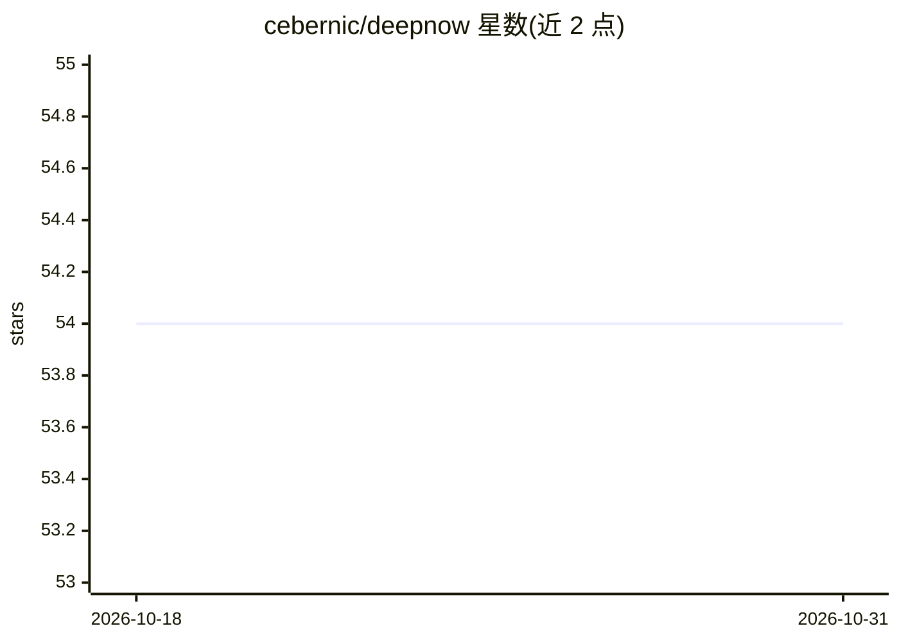

# cebernic/deepnow

⭐ 54 · C · 推送 2026-07-14 · [GitHub](https://github.com/cebernic/deepnow) · 个人维护 · 中文 README

**Go 编写的 LLM 算力网关：多模型聚合调度与内置本地 RAG**

面向个人与企业的 AI 模型网关（路由）独立服务，Go+C 编写，静态编译为单一二进制文件，内嵌 WebUI、sqlite-vec 向量引擎与关系存储。功能包括多模型/多 Key 聚合与负载均衡、Responses/Completions/Messages 协议互译或透传、跨模型上下文迁移、自签发 Key 分发与流量管理、网关层知识库挂载（向量+标签+语义重排混合检索、未命中短路拦截）、主备容灾与节点级联。本地或远端部署，除模型接口地址外无需配置第三方组件。

## 筛选速览

| 维度 | 判定 | 备注 |
|---|---|---|
| AI 角色 | `ai-ecosystem` | LLM/agent 周边工具 |
| 许可风险 | `none` | — |
| 部署形态 | `None` |  |
| 模型依赖 | — | README 未给出锁定关系 |
| 硬件要求 | — | 无带数字的原话,不猜 |
| 安装摩擦 | `low` | 无编译、无系统依赖或容器化 |
| 成熟度 | — | 结构信号不足 |

## 能力要点

- 多模型聚合调度：同模型负载、混合负载、灾备与‘优答’算法（速度优先/推理层级排序）
- 协议 Wrapper：Responses/Completions/Messages 任意互译或透传，支持跨模型上下文投递
- 自签发 Key 系统：按 Key 绑定并发、模型与流量阈值，可统计流量写入 sqlite/mysql
- 内嵌零依赖 RAG：向量+标签+语义重排混合检索，未命中可短路拦截

## 适用场景

- 把多家模型运营商的算力聚合为一个端点，突破 TPM/并发限制
- 团队多人共享模型算力并按 Token 分摊费用、自管 Key
- 为 Codex/Hermes/Claude 等智能体客户端挂载任意协议的模型
- 让所有请求挂载私有知识库，前端无需自行实现 RAG

## 场景标签

`模型网关` `RAG` · 领域:Agent 开发

## 证据(README 行号)

> L33: &nbsp;&nbsp;&nbsp;&nbsp;&nbsp;&nbsp;&nbsp;&nbsp; 在 __Token__ 为王的当下，**Deepnow** 是一个专为个人或企业打造，面向高可用、高并发、全场景适用的 AI 模型网
> L37: &nbsp;&nbsp;&nbsp;&nbsp;&nbsp;&nbsp;&nbsp;&nbsp; Deepnow 是一种可部署到本地或远端 7x24 小时运行、面向各类操作系统、无任何依赖项、可敏捷部署的大模型网关独立服务，由专为
> L43: &nbsp;&nbsp;&nbsp;&nbsp;&nbsp;&nbsp;&nbsp;&nbsp; 当下，市面上眼花缭乱的智能体和层出不穷的模型争相出现，导致前端、后端产生大量的定制化协议。各家都有所谓 OpenAI 兼容的魔改协议

## 星数曲线

2026-10-18 54 → 2026-10-31 54（+0）

---
*卡片 v1 · prompt 1.4 · 生成 2026-10-24 · 置信度 high · 依据 README sha `6507b5e04c9d` · [字段定义](../../DATASET.md)*
