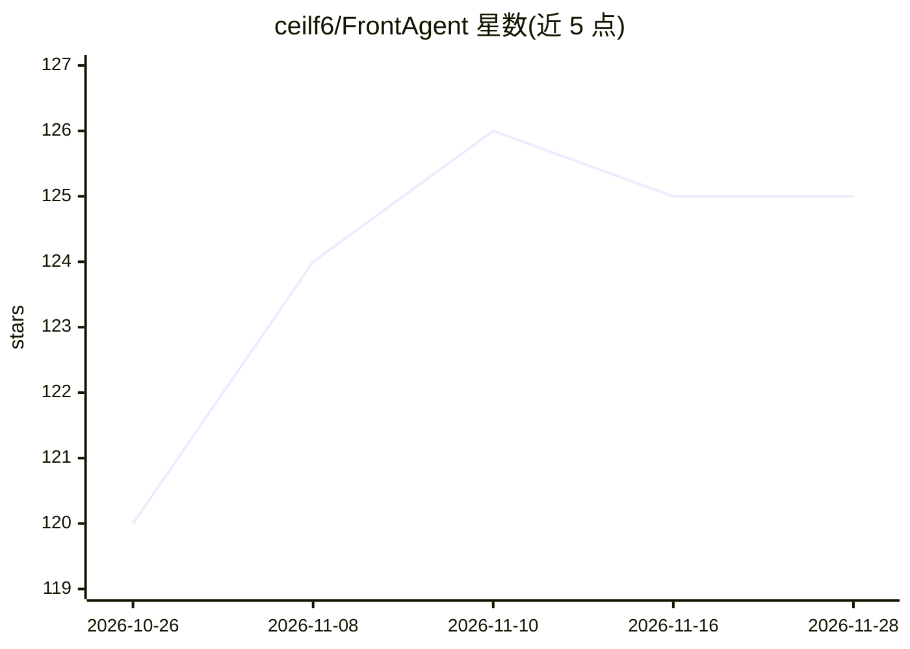

# ceilf6/FrontAgent

⭐ 125 · TypeScript · MIT · 推送 2026-11-25 · [GitHub](https://github.com/ceilf6/FrontAgent) · [官网](https://marketplace.visualstudio.com/items?itemName=ceilf6.frontagent) · 个人维护 · 中文 README

**面向前端工程的 AI 编码 Agent 平台（CLI/VS Code/桌面/MCP）**

开源的前端 AI 编码 Agent，通过结构化执行计划生成与重构 React/TypeScript/Vite/Tailwind 代码，并以 SDD 约束、最小补丁、自愈错误恢复和质量门控限制 Agent 行为。提供三种使用形态：终端 CLI（fa init/fa run）、VS Code 插件侧边栏任务台、Electron 桌面应用；也可作为 stdio MCP Server 接入 Claude Desktop、Cursor 等 MCP 宿主。内置仓库级 RAG（BM25+向量）、Filesense 导航、facts memory、模块依赖追踪与多层幻觉拦截。Planner 阶段蒸馏为 Hugging Face 上的 Qwen Coder 适配器，可本地生成执行计划而无需调用大型 LLM API。运行需 Node.js >=20，通过 npm 全局安装。

## 筛选速览

| 维度 | 判定 | 备注 |
|---|---|---|
| AI 角色 | `ai-native` | 本体是模型或模型工具 |
| 许可风险 | `permissive` | MIT |
| 部署形态 | `desktop` | 安装包/桌面程序 |
| 模型依赖 | — | README 未给出锁定关系 |
| 硬件要求 | — | 无带数字的原话,不猜 |
| 安装摩擦 | `low` | 无编译、无系统依赖或容器化 |
| 成熟度 | — | 结构信号不足 |

## 能力要点

- 两阶段架构：规划与执行分离，含阶段内错误恢复与自愈反馈环
- 仓库级混合 RAG（BM25+语义检索）与模块依赖追踪减少路径幻觉
- 可作 stdio MCP Server 供 Claude Desktop/Cursor/Codex 等宿主调用（6 个工具）
- Planner 蒸馏为 Qwen Coder 适配器，支持本地低成本规划

## 适用场景

- 让 Agent 按结构化计划生成和重构 React/TypeScript 前端代码
- 在 VS Code 或桌面端审批敏感操作并跟踪任务的阶段/步骤进度
- 把前端 Agent 能力以 MCP 服务接入 Claude Desktop、Cursor 等宿主
- 不调用大型 LLM API、用蒸馏模型在本地生成前端执行计划

## 场景标签

`编码 Agent` `RAG` `语义搜索` · 领域:编码与开发

## 证据(README 行号)

> L14: FrontAgent is an open-source AI coding agent for frontend engineering. It helps teams build, modify, validate, and 
> L21: - Run as an AI agent CLI, VS Code AI extension, desktop agent app, or stdio MCP server for Claude Desktop, Cursor, 
> L94: FrontAgent can run as a local stdio MCP Server for MCP hosts such as Claude Desktop, Cursor, Codex, and other clien

## 星数曲线

2026-10-26 120 → 2026-11-28 125（+5）

---
*卡片 v1 · prompt 1.4 · 生成 2026-11-28 · 置信度 high · 依据 README sha `fb6d5b198cdf` · [字段定义](../../DATASET.md)*
