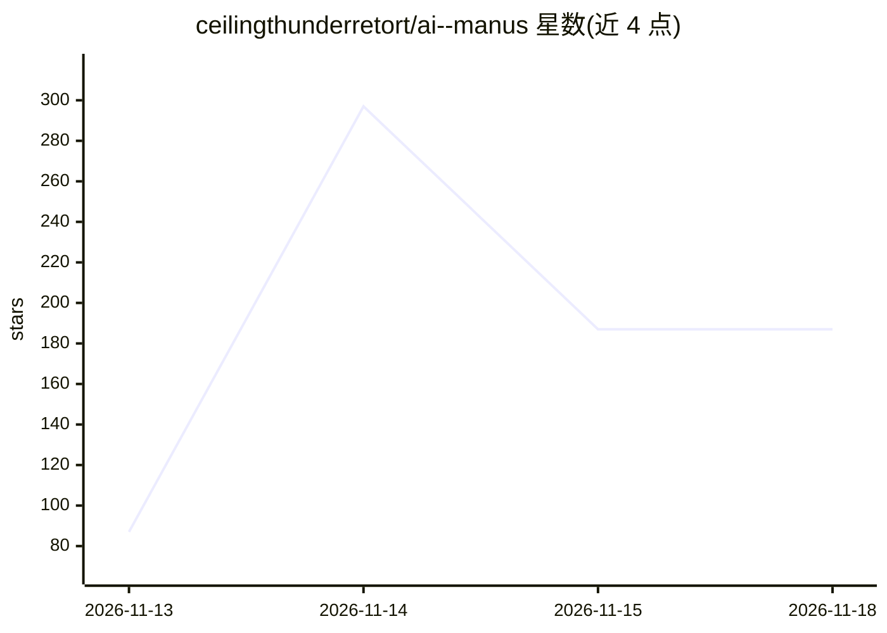

# ceilingthunderretort/ai--manus

⭐ 187 · Apache-2.0 · 推送 2026-11-15 · [GitHub](https://github.com/ceilingthunderretort/ai--manus) · 个人维护

**面向日常任务的自主 AI Agent：代用户运行代码与操控浏览器**

README 描述一个自主 AI Agent 助手：用户描述需求后，Agent 自行编写并执行脚本、打开网页、填写表单、完成多步骤任务，代码执行与浏览器操作可在同一流程中衔接。定位为面向家庭、学习与轻量办公的个人助手，而非企业平台，声称无需开发背景即可使用。README 以功能介绍和使用步骤为主，未给出代码仓库结构、安装命令、模型接入方式或技术实现细节，仅有系统兼容性表（最低 4GB 内存、双核 CPU）。

## 筛选速览

| 维度 | 判定 | 备注 |
|---|---|---|
| AI 角色 | `ai-native` | 本体是模型或模型工具 |
| 许可风险 | `permissive` | Apache-2.0 |
| 部署形态 | `None` |  |
| 模型依赖 | — | README 未给出锁定关系 |
| 硬件要求 | — | 无带数字的原话,不猜 |
| 安装摩擦 | `low` | 无编译、无系统依赖或容器化 |
| 成熟度 | — | 结构信号不足 |

## 能力要点

- 自主代码执行：Agent 自行编写并运行脚本完成任务
- 浏览器控制：导航网页、填表、采集信息
- 代码与浏览器操作在同一工作流中衔接，支持跨会话记忆模式

## 适用场景

- 让学生整理研究笔记、跑快速计算
- 远程工作者从多页面收集数据并汇总
- 把重复性的小任务交给后台助手处理

## 场景标签

`AI 助手` `编码 Agent` `浏览器自动化` · 领域:效率与自动化

## 证据(README 行号)

> L10: - **Autonomous Code Execution:** Manus AI agent runs code on its own to complete tasks, so you can focus on decisio
> L18: Manus is an autonomous AI agent designed to run code and control a browser on your behalf. Instead of acting like a

## 星数曲线

2026-11-13 87 → 2026-11-18 187（+100）

---
*卡片 v1 · prompt 1.4 · 生成 2026-11-17 · 置信度 low · 依据 README sha `fbfd5e977bf4` · [字段定义](../../DATASET.md)*
