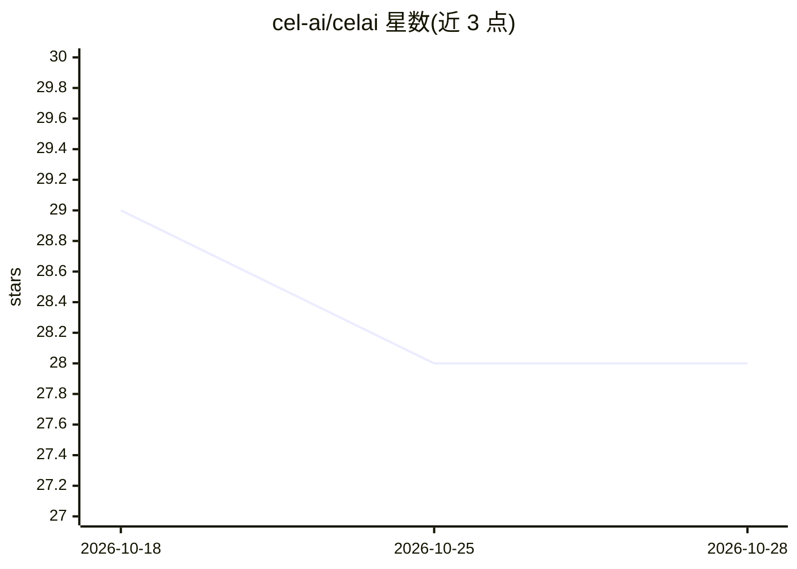

# cel-ai/celai

⭐ 28 · Python · MIT · 推送 2026-09-21 · [GitHub](https://github.com/cel-ai/celai) · [官网](https://cel-ai.github.io/celai/) · 组织维护

**面向开发者的全渠道 AI 虚拟助手构建框架**

Cel.ai 是一个自托管的 AI 通信平台框架，用于加速构建全渠道虚拟助手：通过 WhatsApp、Telegram、VAPI.ai、Chatwoot 等连接器接入消息与语音渠道。核心机制包括多助手路由（基于状态变量的逻辑路由、基于用户意图与上下文的 Agentic 路由，语义路由标注为开发中）、工具调用、事件系统、审核与黑名单中间件，基于 LangChain 构建，支持 LangSmith 用户追踪与 Ngrok 集成。以 Python 包形式提供，需配置 LLM API key 与渠道 token 运行。

## 筛选速览

| 维度 | 判定 | 备注 |
|---|---|---|
| AI 角色 | `ai-ecosystem` | LLM/agent 周边工具 |
| 许可风险 | `permissive` | MIT |
| 部署形态 | `library` | 以包/库形式分发 |
| 模型依赖 | — | README 未给出锁定关系 |
| 硬件要求 | — | 无带数字的原话,不猜 |
| 安装摩擦 | `low` | 无编译、无系统依赖或容器化 |
| 成熟度 | `idea` | |

## 能力要点

- 多助手路由：逻辑路由、Agentic 路由（语义路由标注 coming soon）
- WhatsApp / Telegram / VAPI.ai / Chatwoot 连接器
- 基于 LangChain 构建，支持 LangSmith 追踪
- 审核与黑名单中间件、事件系统、Ngrok 原生集成

## 适用场景

- 构建同时接入 Telegram、WhatsApp 等渠道的客服或业务助手
- 按用户意图将对话路由到不同职能助手（如酒店预订、退订、退房）
- 自托管部署替代托管平台以获得定制与扩展能力

## 场景标签

`Agent 框架` · 领域:Agent 开发

## 证据(README 行号)

> L5: Cel.ai is a AI Driven Communication Platform. Designed to accelerate the development of omnichannel virtual assistan
> L23: - Powered by Langchain
> L35: Cel.ai provides a powerful multi-assistant router that allows you to create complex conversational assistants easil

## 星数曲线

2026-10-18 29 → 2026-10-28 28（-1）

---
*卡片 v1 · prompt 1.4 · 生成 2026-10-26 · 置信度 high · 依据 README sha `423fcf2f7fee` · [字段定义](../../DATASET.md)*
