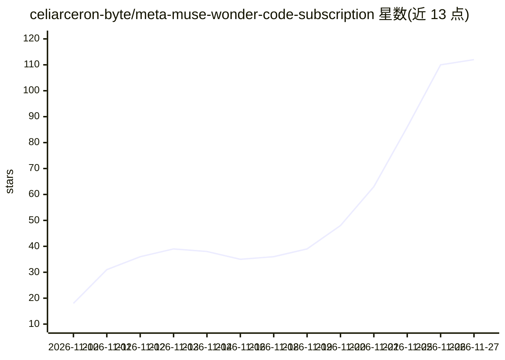

# celiarceron-byte/meta-muse-wonder-code-subscription

⭐ 112 · 推送 2026-11-09 · [GitHub](https://github.com/celiarceron-byte/meta-muse-wonder-code-subscription) · [官网](https://app.coregold.io/signup?invite_code=ADvlj9b) · 个人维护 · 中文 README

**推广 CoreGold 虚拟卡以开通 AI 编程模型订阅的营销内容**

仓库名义上讨论 Meta Muse Wonder 与 Muse Code 编程模型订阅的付款问题（海外商户代码拒付、团队多席位开通），实际主体为 CoreGold 独立商用虚拟卡的推广：介绍其卡段特征、AVS 账单匹配、USDT 链上充值流程，并给出充值 25 USDT、设定单卡限额、在升级页面填卡付款的实操步骤，文末附控制台入口链接与一串十六进制字符串。不包含任何代码、安装方式或可运行组件。

## 筛选速览

| 维度 | 判定 | 备注 |
|---|---|---|
| AI 角色 | `ai-enhanced` | 去掉 AI 部分产品仍成立 |
| 许可风险 | `none` | — |
| 部署形态 | `None` |  |
| 模型依赖 | — | README 未给出锁定关系 |
| 硬件要求 | — | 无带数字的原话,不猜 |
| 安装摩擦 | `low` | 无编译、无系统依赖或容器化 |
| 成熟度 | — | 结构信号不足 |

## 能力要点

- 主题为 AI 编程模型订阅的支付/拒付问题与团队多席位开通
- 介绍 CoreGold 商用虚拟卡的卡段、AVS 指标与 USDT 充值流程
- 给出三步开通实操步骤（充值、下发卡片、填入付款）

## 适用场景

- 了解 AI 订阅付款被拒时的一种虚拟卡方案（内容为营销推广）

## 场景标签

 · 领域:支付服务推广

## 证据(README 行号)

> L2: Meta Muse Wonder 与 Muse Code 编程模型订阅避坑：解决海外商户代码拒付与团队多席位开通。
> L16: + CoreGold 独立商用卡:
> L29: 1. **充值注资**：打开 CoreGold 控制台，充入 25 USDT（留足预授权与税费缓冲）。

## 星数曲线

2026-11-10 18 → 2026-11-27 112（+94）

---
*卡片 v1 · prompt 1.4 · 生成 2026-11-18 · 置信度 mid · 依据 README sha `e39f132407af` · [字段定义](../../DATASET.md)*
