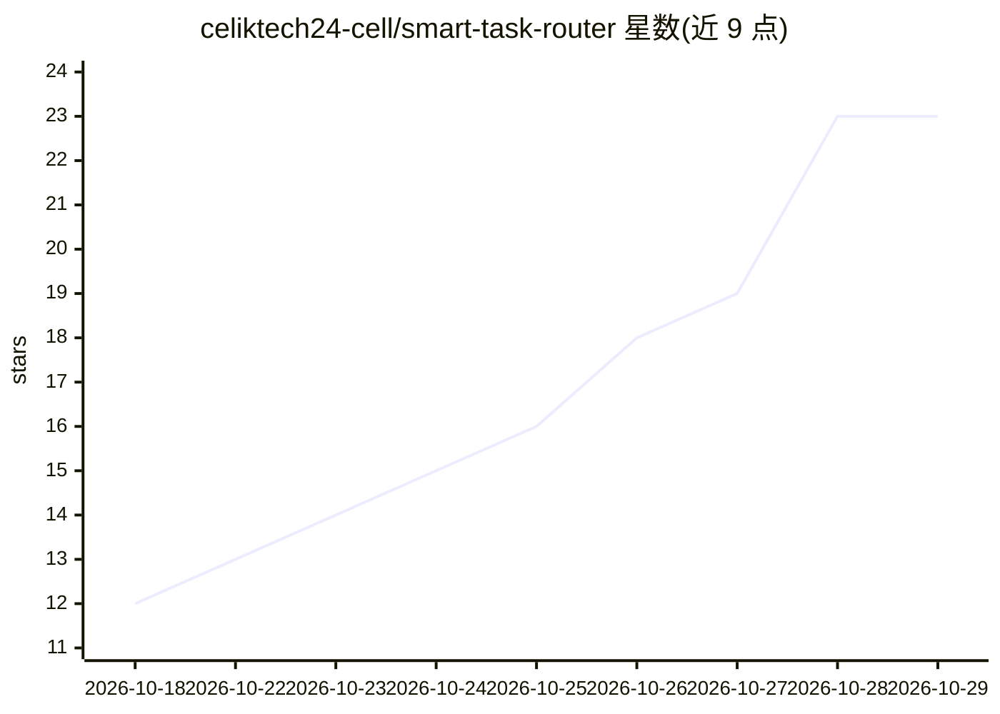

# celiktech24-cell/smart-task-router

⭐ 23 · MIT · 推送 2026-10-05 · [GitHub](https://github.com/celiktech24-cell/smart-task-router) · 个人维护

**Claude Code 的任务路由 skill：按子任务选模型与档位并逐级校验**

面向 Claude Code 的 skill + plugin：先用强模型（Opus）产出计划与验收标准，再按 E/N/H 三档将子任务分派给不同模型与 effort（Haiku low / Sonnet medium / Opus high），每个任务完成后由 Claude 校验并作为 checkpoint 提交，校验失败才升级档位，Opus 连续失败两次则改写计划。进度保存于 .router/ 目录可跨会话续作。通过 plugin marketplace 或手动复制文件安装；claude.ai/桌面端仅支持 skill 部分，effort 控制仅限 Claude Code。

## 筛选速览

| 维度 | 判定 | 备注 |
|---|---|---|
| AI 角色 | `ai-ecosystem` | LLM/agent 周边工具 |
| 许可风险 | `permissive` | MIT |
| 部署形态 | `desktop` | 安装包/桌面程序 |
| 模型依赖 | — | README 未给出锁定关系 |
| 硬件要求 | — | 无带数字的原话,不猜 |
| 安装摩擦 | `low` | 无编译、无系统依赖或容器化 |
| 成熟度 | — | 结构信号不足 |

## 能力要点

- 按子任务分派 E/N/H 三档模型与 effort，失败才升级
- Opus 产出计划与验收标准，构建前需用户批准
- 进度写入 .router/PROGRESS.md，可跨会话续作
- 输出任务档位分布统计（如 12 tasks: 5E 5N 2H）

## 适用场景

- 在 Claude Code 中降低多任务开发的 token 开销
- 把样板类任务交给低档模型、核心逻辑留给强模型
- 中断后通过 'continue the project' 恢复项目进度

## 场景标签

`提示工程` · 领域:Agent 开发

## 证据(README 行号)

> L7: Most work doesn't need the biggest Claude model on max effort. This skill makes Claude pick the cheapest model and e
> L14: |**Router (this repo)**|A plan picks model + effort per subtask, verifies, escalates on fail|**¢**|

## 星数曲线

2026-10-18 12 → 2026-10-29 23（+11）

---
*卡片 v1 · prompt 1.4 · 生成 2026-10-28 · 置信度 high · 依据 README sha `570a900dc69f` · [字段定义](../../DATASET.md)*
