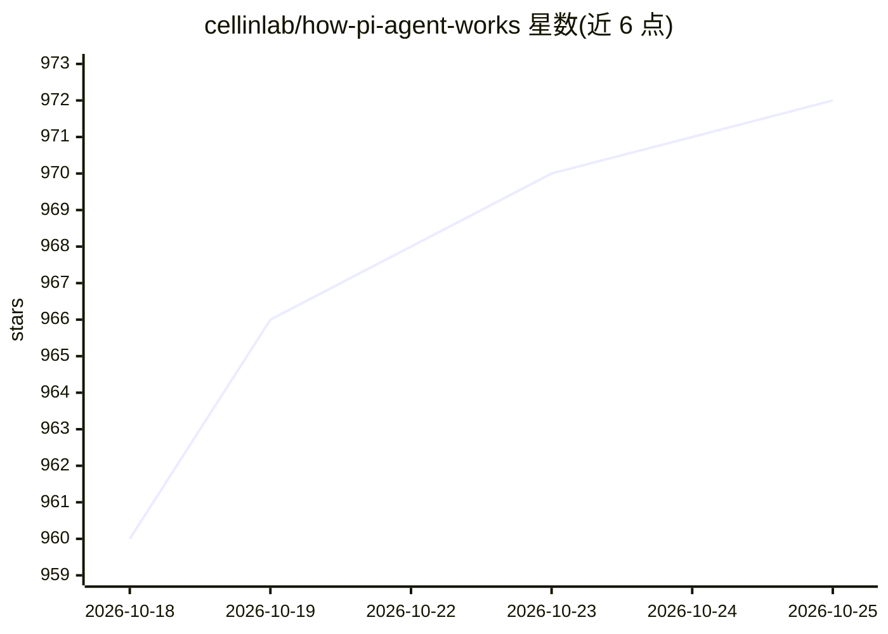

# cellinlab/how-pi-agent-works

⭐ 972 · MIT · 推送 2026-05-26 · [GitHub](https://github.com/cellinlab/how-pi-agent-works) · [官网](https://how-pi-agent-works.vercel.app) · 个人维护 · 中文 README

**从零实现 AI Agent 的中文 VitePress 教程项目**

参考 earendil-works/pi 与 pi.dev 官方文档的中文教程项目，按学习路径拆解 Pi Agent 原理：Agent Loop、消息、流式事件、工具调用、会话树、上下文压缩等概念讲解，pi-ai/pi-agent-core/pi-coding-agent 源码分层拆解，四个渐进式 TypeScript Demo 与一个可选真模型烟测 Demo，最终以 React + Node.js + TypeScript 实现可运行的教学版 Agent。教程站点为 VitePress 静态站点，教学 Agent 的 Express API 仅本地运行。

## 筛选速览

| 维度 | 判定 | 备注 |
|---|---|---|
| AI 角色 | `ai-knowledge` | 知识聚合/清单类 |
| 许可风险 | `permissive` | MIT |
| 部署形态 | `library` | 以包/库形式分发 |
| 模型依赖 | — | README 未给出锁定关系 |
| 硬件要求 | — | 无带数字的原话,不猜 |
| 安装摩擦 | `low` | 无编译、无系统依赖或容器化 |
| 成熟度 | — | 结构信号不足 |

## 能力要点

- 覆盖 Agent Loop、工具调用、会话树、上下文压缩等核心概念的讲解
- 四个渐进式 TypeScript Demo，从最小循环逐步增加功能
- React + Node.js 教学版 Agent 可本地运行（前端 5174/API 4317）
- 可选真模型烟测通过 OpenAI 兼容环境变量接入

## 适用场景

- 系统学习 AI Agent 的原理与工程实现
- 跟随渐进式 Demo 动手实现教学版 Agent
- 查阅 Pi Agent 源码的分层拆解讲解

## 场景标签

`教程课程` · 领域:学习与行业

## 证据(README 行号)

> L3: 这是一个完整可运行的中文 VitePress 教程项目，参考 earendil-works/pi 与 pi.dev 官方文档，从工程视角拆解 Pi Agent 的核心原理，并带你实现一个教学版 Agent。
> L10: - 最终项目：React + Node.js + TypeScript 实现一个可运行的教学版 Agent。
> L83: docs/                         # VitePress 教程站点

## 星数曲线

2026-10-18 960 → 2026-10-25 972（+12）

---
*卡片 v1 · prompt 1.4 · 生成 2026-10-21 · 置信度 high · 依据 README sha `f0574f3376dd` · [字段定义](../../DATASET.md)*
