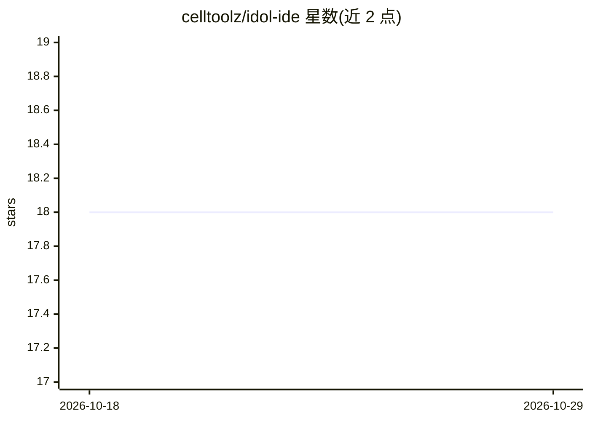

# celltoolz/idol-ide

⭐ 18 · Python · MIT · 推送 2026-08-06 · [GitHub](https://github.com/celltoolz/idol-ide) · 个人维护

**纯 Python 编写的 Python IDE：拖拽 Tkinter GUI 设计器+LSP/调试/Git/AI**

面向 Python 学习者与开发者的桌面 IDE，纯 Python/ Tkinter 实现，无 Electron。内置 VB6 风格的拖拽式 Tkinter GUI 设计器（17 种控件、非可视组件、Handlers 系统、Canvas 元素设计器），并带 ruff/pylsp 诊断补全、debugpy 调试器、Git 集成、VT100 终端、conda/venv 环境管理与包管理器。AI 部分：通过本地 Ollama 提供离线 AI 聊天（F2）、点击式学习讲解（F1）。跨 Windows/macOS/Linux 运行。

## 筛选速览

| 维度 | 判定 | 备注 |
|---|---|---|
| AI 角色 | `ai-enhanced` | 去掉 AI 部分产品仍成立 |
| 许可风险 | `permissive` | MIT |
| 部署形态 | `library` | 以包/库形式分发 |
| 模型依赖 | local-ok | 支持本地模型 |
| 硬件要求 | — | 无带数字的原话,不猜 |
| 安装摩擦 | `low` | 无编译、无系统依赖或容器化 |
| 成熟度 | — | 结构信号不足 |

## 能力要点

- VB6 风格拖拽式 Tkinter GUI 设计器，生成类式代码
- 本地 Ollama 离线 AI 聊天与学习模式讲解，无需 API key
- 内置 debugpy 调试器、ruff/pylsp 诊断、Git 集成与 VT100 终端
- conda 与 venv 环境检测、切换与包管理

## 适用场景

- 可视化拖拽设计 Tkinter 界面并生成代码
- 初学者通过点击任意 IDE 元素获得讲解来学习 Python 开发
- 在单一纯 Python IDE 中完成编辑、调试、Git 与包管理

## 场景标签

`代码生成` · 领域:编码与开发

## 证据(README 行号)

> L15: IDOL is what IDLE could have been — a full Python IDE with professional-grade tools (Designer, LSP, git, terminal, 
> L94: Click any IDE element for a three-section explanation (what it is, how it works, real-world example) — the click is

## 星数曲线

2026-10-18 18 → 2026-10-29 18（+0）

---
*卡片 v1 · prompt 1.4 · 生成 2026-10-29 · 置信度 high · 依据 README sha `dc09d1f5816b` · [字段定义](../../DATASET.md)*
