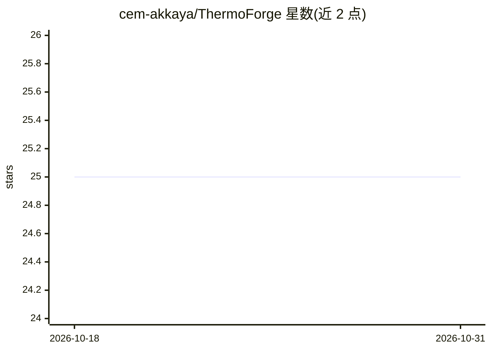

# cem-akkaya/ThermoForge

⭐ 25 · C++ · MIT · 推送 2025-12-15 · [GitHub](https://github.com/cem-akkaya/ThermoForge) · [官网](https://github.com/cem-akkaya/ThermoForge) · 个人维护

**Unreal Engine 热与气候模拟查询插件，供游戏开发者构建温度系统**

面向 UE 项目的编辑器插件：烘焙天空可见度、墙体渗透率、室内因子等几何场，叠加天气、海拔、昼夜循环与动态热源，在世界任意位置生成温度值，供 Blueprints 与 C++ 查询。核心由 Thermo Forge Volume、Heat Source 组件与 World Subsystem 组成，基于预计算场并做运行时调整，无需引擎修改或物理资产。另提供 AI 辅助：EQS 温度测试、AI Perception 热感知与热事件，以及热视觉后处理材质。README 声明仍在开发中、属实验性质。

## 筛选速览

| 维度 | 判定 | 备注 |
|---|---|---|
| AI 角色 | `ai-enhanced` | 去掉 AI 部分产品仍成立 |
| 许可风险 | `permissive` | MIT |
| 部署形态 | `None` |  |
| 模型依赖 | — | README 未给出锁定关系 |
| 硬件要求 | — | 无带数字的原话,不猜 |
| 安装摩擦 | `low` | 无编译、无系统依赖或容器化 |
| 成熟度 | `idea` | |

## 能力要点

- 体素级热场烘焙（天空视野/墙体渗透率/室内代理）与气候模拟（昼夜/季节/海拔递减率）
- 世界任意位置温度查询，Blueprint 与 C++ 双接口
- AI 辅助：EQS 温度测试、Thermal Sense 感知配置、热事件
- 热视觉后处理材质与 Heat FX 组件（Custom Primitive Data 驱动）

## 适用场景

- 为开放世界游戏提供任意位置的实时温度模拟
- 实现基于温度的 AI 行为（热感知、EQS 寻热、环境驱动机制）
- 制作热成像视觉效果与随温度变化的材质

## 场景标签

 · 领域:游戏开发/物理模拟

## 证据(README 行号)

> L12: Thermo Forge is an Unreal Engine plugin for simulating and querying heat, climate, and thermal conditions in your l
> L17: Thermo Forge is designed for seamless gameplay integration, from AI “heat sense” behaviors to environment-driven me

## 星数曲线

2026-10-18 25 → 2026-10-31 25（+0）

---
*卡片 v1 · prompt 1.4 · 生成 2026-10-27 · 置信度 high · 依据 README sha `8537a47a54df` · [字段定义](../../DATASET.md)*
