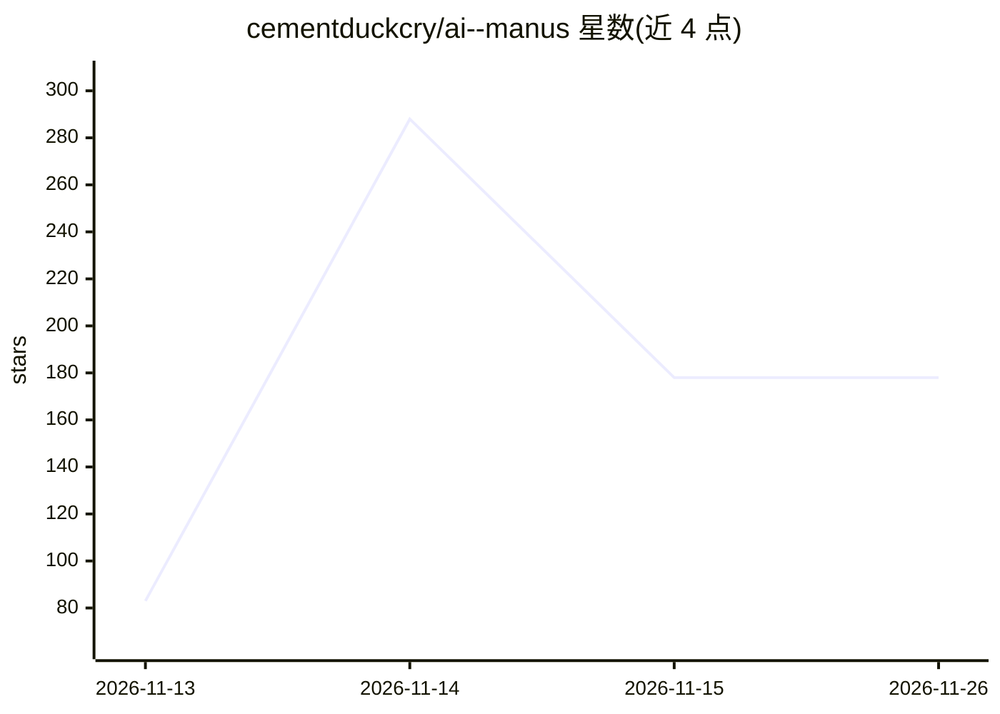

# cementduckcry/ai--manus

⭐ 178 · Apache-2.0 · 推送 2026-11-15 · [GitHub](https://github.com/cementduckcry/ai--manus) · 个人维护

**自主 AI Agent 系统：代用户执行代码与控制浏览器完成任务**

README 描述的自主 AI 代理：用户以自然语言下达指令，代理自行编写并执行脚本、打开网页、与页面元素交互、执行多步骤任务，代码执行与浏览器控制可在同一任务流中衔接；定位为面向家庭、学习与轻量办公的个人助手，而非企业平台。描述称支持记忆工作流模式以在会话间复用。README 为宣传性文本，未提供任何安装命令、代码结构、技术架构或模型接入细节，无法核实实现方式；仅给出兼容性表（最低 4 GB 内存、双核 CPU）。

## 筛选速览

| 维度 | 判定 | 备注 |
|---|---|---|
| AI 角色 | `ai-native` | 本体是模型或模型工具 |
| 许可风险 | `permissive` | Apache-2.0 |
| 部署形态 | `None` |  |
| 模型依赖 | — | README 未给出锁定关系 |
| 硬件要求 | — | 无带数字的原话,不猜 |
| 安装摩擦 | `low` | 无编译、无系统依赖或容器化 |
| 成熟度 | — | 结构信号不足 |

## 能力要点

- 自主编写并执行代码完成任务的 Agent
- 浏览器控制：导航网页、填表、采集信息
- 代码与浏览器操作在同一任务流中衔接
- 面向学习、家庭与轻量办公的小规模场景

## 适用场景

- 让代理代为执行网页信息采集与表单填写
- 用自然语言让代理运行小脚本和处理日常重复任务
- 学习与轻度办公中委托多步骤杂务

## 场景标签

`AI 助手` `浏览器自动化` `编码 Agent` · 领域:效率与自动化

## 证据(README 行号)

> L10: - **Autonomous Code Execution:** Manus AI agent runs code on its own to complete tasks, so you can focus on decisio
> L18: Manus is an autonomous AI agent designed to run code and control a browser on your behalf. Instead of acting like a

## 星数曲线

2026-11-13 83 → 2026-11-26 178（+95）

---
*卡片 v1 · prompt 1.4 · 生成 2026-11-17 · 置信度 mid · 依据 README sha `0f78ee3a5dd2` · [字段定义](../../DATASET.md)*
