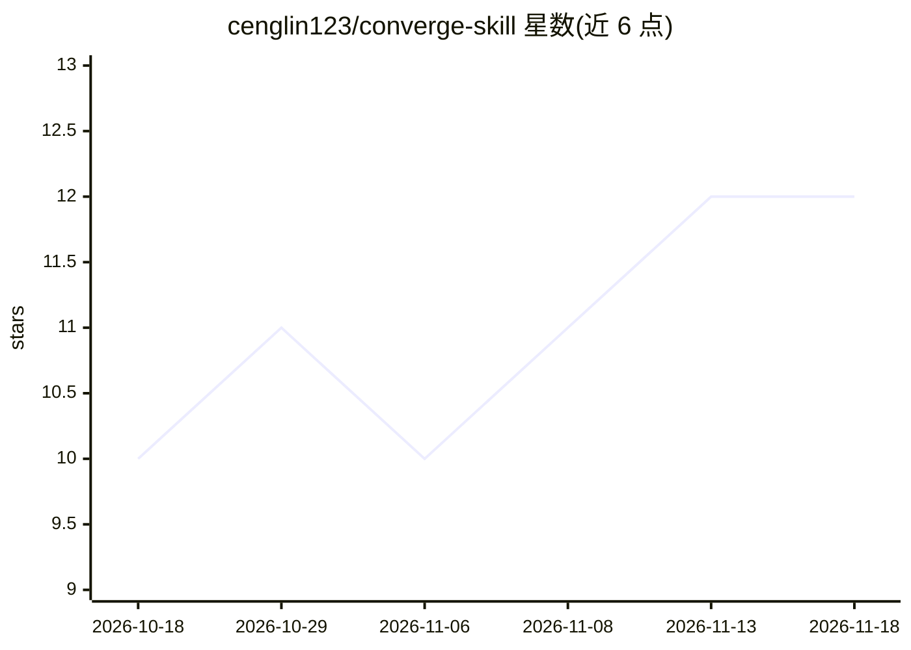

# cenglin123/converge-skill

⭐ 12 · Python · 推送 2026-09-12 · [GitHub](https://github.com/cenglin123/converge-skill) · 个人维护 · 中文 README

**给 AI Agent 团队的双 Agent 对抗式审查收敛器**

以 SKILL.md 形式提供的多 Agent 工作流技能，用独立 Reviewer 与 Executor 的对抗循环迭代审查计划与代码产物，直到产出可执行 verdict 或触发停止条件。核心机制包括预算 gate 脚本（stdlib only 的 budget_gate.py）在每次 spawn 前裁决额度、五类终止状态判定、反模式注册表随命中频率衰减。框架无关：通过抽象能力层适配 Claude Code、opencode、Codex 等宿主，预算硬阻断能力按宿主分 tier。

## 筛选速览

| 维度 | 判定 | 备注 |
|---|---|---|
| AI 角色 | `ai-ecosystem` | LLM/agent 周边工具 |
| 许可风险 | `none` | — |
| 部署形态 | `None` |  |
| 模型依赖 | — | README 未给出锁定关系 |
| 硬件要求 | — | 无带数字的原话,不猜 |
| 安装摩擦 | `low` | 无编译、无系统依赖或容器化 |
| 成熟度 | — | 结构信号不足 |

## 能力要点

- Reviewer/Executor 每轮以全新上下文 spawn 的对抗式审查循环
- 确定性预算 gate 脚本（stdlib only）在 spawn 前后裁决额度
- 五种终止状态与振荡硬停判定
- 框架无关抽象能力层，适配 Claude Code / opencode / Codex

## 适用场景

- AI 生成的计划或代码在执行前需要独立交叉验证
- 复杂交付物要求零阻断的质量门控
- 组合进 Dynamic Workflows 作为质量门控环节

## 场景标签

`多智能体` `代码审查` · 领域:Agent 开发

## 证据(README 行号)

> L3: 双 Agent 迭代收敛，专为 AI 生成产物设计。不同于脚本化工作流，converge 使用独立 Agent 之间的**对抗式审查循环**，通过迭代驱动质量提升——直到 Reviewer 给出 `可执行` verdict 或触发停
> L5: > **框架无关**：Reviewer / Executor 的启动和续命通过抽象能力层（Spawn / Continue / Identify）实现，不绑定特定框架 API。核心预算裁决脚本（file-authoritative 

## 星数曲线

2026-10-18 10 → 2026-11-18 12（+2）

---
*卡片 v1 · prompt 1.4 · 生成 2026-11-18 · 置信度 mid · 依据 README sha `fced370134f5` · [字段定义](../../DATASET.md)*
