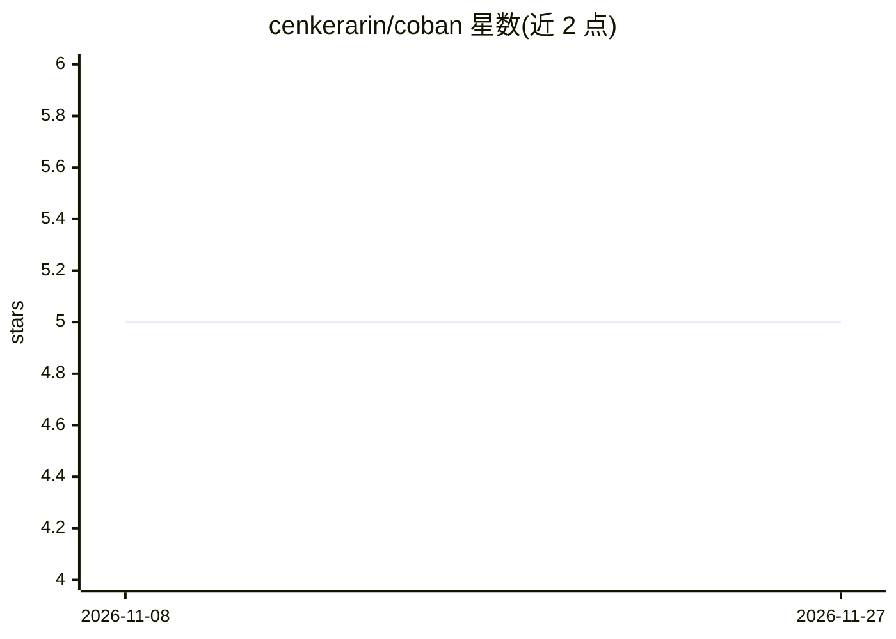

# cenkerarin/coban

⭐ 5 · TypeScript · MIT · 推送 2026-11-19 · [GitHub](https://github.com/cenkerarin/coban) · 个人维护

**终端多 agent 编排器：把任务分派给多个 AI 编码 CLI 并集中监督**

基于 Node.js（≥24）的终端 TUI 应用，用单个编排 agent 将用户请求拆分并派发给多个 AI 编码 agent（多个 Claude Code 账户、Codex、OpenCode、Cursor CLI），agent 间通过私信与共享看板互通。每个 agent 运行在独立 PTY 中，coban 通过模拟屏幕读取状态（working/blocked/limited 等）；集中呈现权限审批、账户用量统计，用量触顶时把任务转给消耗最少的同类账户。支持 git worktree 隔离、spawn 队列与 verify 验证门。UI 与提示词当前为土耳其语，版本 v0.3，作者自述处于早期阶段。

## 筛选速览

| 维度 | 判定 | 备注 |
|---|---|---|
| AI 角色 | `ai-ecosystem` | LLM/agent 周边工具 |
| 许可风险 | `permissive` | MIT |
| 部署形态 | `library` | 以包/库形式分发 |
| 模型依赖 | — | README 未给出锁定关系 |
| 硬件要求 | — | 无带数字的原话,不猜 |
| 安装摩擦 | `low` | 无编译、无系统依赖或容器化 |
| 成熟度 | `idea` | |

## 能力要点

- 多 Claude 账户负载分配：按 5 小时用量把任务派给消耗最少的账户
- 每个 agent 独立 PTY + xterm 屏幕模拟读取状态，无需 MCP server
- 集中审批收件箱：y/a/r 一键回答所有 agent 的权限提问
- --worktree 隔离、--after 队列依赖、--verify 失败回传修复

## 适用场景

- 手头有多个 Claude 账户，想在终端并行分派编码任务
- 让多个 agent 分工改代码并通过看板同步接口变更
- 集中处理多个 agent 的权限审批与用量监控

## 场景标签

`多智能体` `编码 Agent` · 领域:Agent 开发

## 证据(README 行号)

> L6: **One orchestrator agent splits your request and hands the pieces to many AI coding agents** — several Claude Code
> L59:  system prompt that teaches it the `coban` command, which talks to the app over a unix socket. Anything that can
> L25: - **You stay in control.** Permission questions from every agent land in one place and you answer them in a keystro

## 星数曲线

2026-11-08 5 → 2026-11-27 5（+0）

---
*卡片 v1 · prompt 1.4 · 生成 2026-11-21 · 置信度 high · 依据 README sha `3496da482b5f` · [字段定义](../../DATASET.md)*
