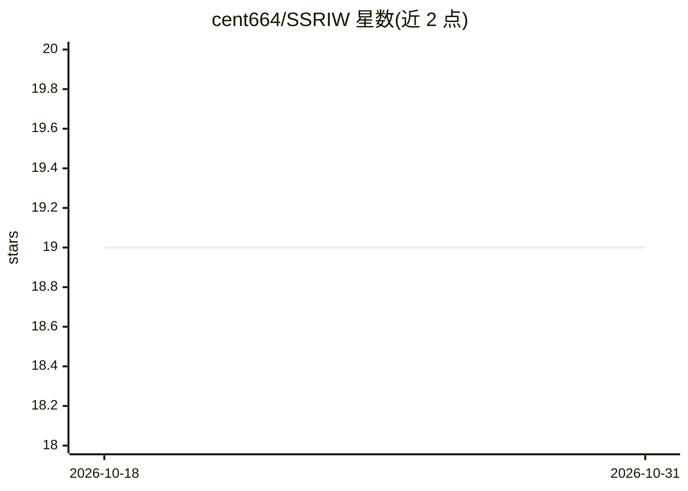

# cent664/SSRIW

⭐ 19 · Jupyter Notebook · Apache-2.0 · 推送 2025-11-11 · [GitHub](https://github.com/cent664/SSRIW) · [官网](https://ieeexplore.ieee.org/document/10590390) · 个人维护

**论文官方 TensorFlow 实现：基于交叉注意力的鲁棒图像水印**

CSCI 2023 论文 'Robust Image Watermarking based on Cross-Attention and Invariant Domain Learning' 的 TensorFlow 实现，作者 Dasgupta 与 Zhong。方法将载体图像与水印分解为向量并加入位置嵌入，经多头注意力层计算两图 patch 间的注意力分数，据此确定水印嵌入位置；水印由图像缩放、取首通道并按阈值 128 二值化生成（128x128x3 载体图像）。README 提供讲解视频与 Google Drive 预训练权重链接，含噪声容忍实验说明与 BibTeX 引用；未给出安装与运行命令。

## 筛选速览

| 维度 | 判定 | 备注 |
|---|---|---|
| AI 角色 | `ai-native` | 本体是模型或模型工具 |
| 许可风险 | `permissive` | Apache-2.0 |
| 部署形态 | `None` |  |
| 模型依赖 | — | README 未给出锁定关系 |
| 硬件要求 | — | 无带数字的原话,不猜 |
| 安装摩擦 | `low` | 无编译、无系统依赖或容器化 |
| 成熟度 | — | 结构信号不足 |

## 能力要点

- MHA 交叉注意力分配水印嵌入位置
- 水印由首通道二值化（阈值 128）生成
- 提供 Google Drive 预训练权重与讲解视频
- 含噪声容忍度实验结果展示

## 适用场景

- 复现论文中的交叉注意力图像水印方法
- 研究水印嵌入位置选择与噪声鲁棒性
- 基于预训练权重做图像水印实验

## 场景标签

`图像视频处理` · 领域:感知与多模态

## 证据(README 行号)

> L9: We propose utilizing MHA in image watermarking to allocate watermarks across various regions based on relevance. The
> L30: @INPROCEEDINGS{10590390,

## 星数曲线

2026-10-18 19 → 2026-10-31 19（+0）

---
*卡片 v1 · prompt 1.4 · 生成 2026-10-28 · 置信度 high · 依据 README sha `328ecec49000` · [字段定义](../../DATASET.md)*
