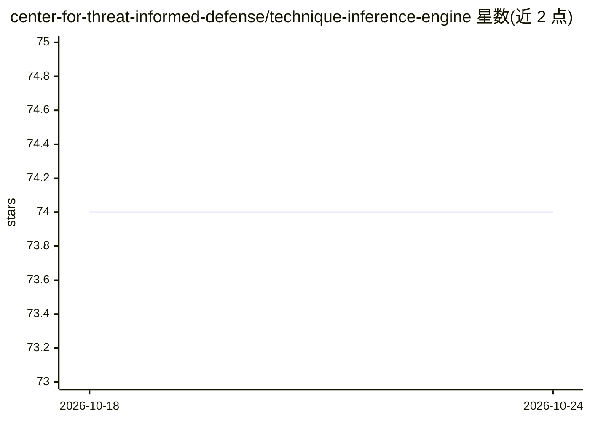

# center-for-threat-informed-defense/technique-inference-engine

⭐ 74 · Jupyter Notebook · Apache-2.0 · 推送 2026-09-04 · [GitHub](https://github.com/center-for-threat-informed-defense/technique-inference-engine) · [官网](https://ctid.io/tie) · 组织维护

**由已观测 ATT&CK 技术预测对手后续技术的 ML 模型**

MITRE 威胁知情防御中心（CTID）维护的机器学习引擎：从已观测的 MITRE ATT&CK 技术推断对手可能使用的关联技术，帮助防御者预判对手下一步行动。附带同类中规模较大的公开数据集，将 CTI 报告与 ATT&CK 技术关联，含 6,236 份 CTI 报告的 43,899 条技术观测，覆盖 ATT&CK Enterprise v15.0 的 96%。面向网络安全防御人员与机器学习工程师，可通过官网在浏览器中运行，或用官方 Python Notebook 在本地训练自定义模型；亦接受社区贡献 CTI 数据扩充数据集。以 Apache-2.0 许可开源。

## 筛选速览

| 维度 | 判定 | 备注 |
|---|---|---|
| AI 角色 | `ai-native` | 本体是模型或模型工具 |
| 许可风险 | `permissive` | Apache-2.0 |
| 部署形态 | `None` |  |
| 模型依赖 | — | README 未给出锁定关系 |
| 硬件要求 | — | 无带数字的原话,不猜 |
| 安装摩擦 | `low` | 无编译、无系统依赖或容器化 |
| 成熟度 | — | 结构信号不足 |

## 能力要点

- 从已观测 ATT&CK 技术预测关联技术
- 43,899 条技术观测 / 6,236 份 CTI 报告的数据集
- 覆盖 ATT&CK Enterprise v15.0 的 96%
- 提供浏览器运行入口与可本地训练的 Python Notebook

## 适用场景

- 基于已观测的入侵技术预判对手后续行动
- 用自有 CTI 数据训练自定义推断模型
- 获取 CTI 报告与 ATT&CK 技术关联的公开数据集

## 场景标签

`网络安全` · 领域:学习与行业

## 证据(README 行号)

> L5: The Technique Inference Engine (TIE) allows cyber defenders to forecast an adversary's
> L6: next steps by predicting associated MITRE ATT&CK>)
> L7: techniques from previously observed techniques. TIE enables defenders to build a

## 星数曲线

2026-10-18 74 → 2026-10-24 74（+0）

---
*卡片 v1 · prompt 1.4 · 生成 2026-10-24 · 置信度 high · 依据 README sha `a3f0c0fce815` · [字段定义](../../DATASET.md)*
